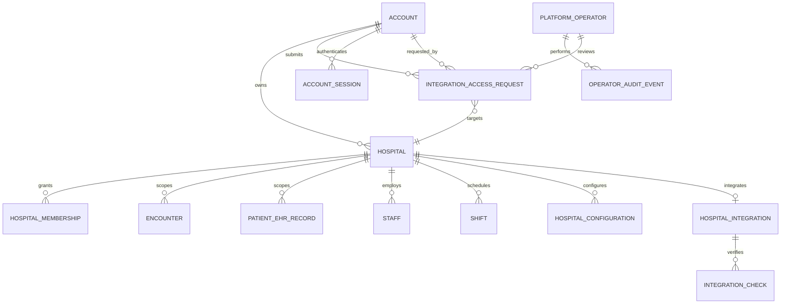

# Account, Hospital Ownership, and Integration Governance Plan

## Purpose

Define a clear identity and ownership model for the hospital platform before changing the registration and dashboard journeys. The design separates the real website account that owns hospital workspaces, hospital-local administrator credentials, and internal Nurshelpdesk engineering access.

This is an architecture plan, not an implementation. The findings below are based on the active source under `nurshelp/backend/src` and `nurshelp/frontend/src`.

## Goals

- Let a person register a real Nurshelpdesk account and get an account-level experience.
- Let that account create and own one or more hospital workspaces.
- Keep hospital administrator credentials separate from the website account; each hospital admin belongs to one hospital, and a hospital may have multiple admins.
- Reserve live HL7/FHIR setup and integration diagnostics for authenticated Nurshelpdesk company operators.
- Let a hospital request live integration access without granting the hospital permission to configure company-controlled integration infrastructure.
- Show an honest Live/Offline indicator in hospital selectors, based on verified connection status rather than a configured label.
- Preserve hospital-level isolation for staff, encounters, patient records, and hospital configuration.

## Current-State Diagnosis

### Identities and registration

- There is no dedicated website-owner account model or public account-signup endpoint in the active backend. Unified login searches `Manager`, then `ClinicalStaff`/`Practitioner`: [auth.controller.js](nurshelp/backend/src/controllers/auth.controller.js).
- `POST /api/hospital/register` is public. It creates the hospital and an `ADMIN` `Manager` in one flow, then returns a hospital-scoped token. This makes the registering person the hospital admin rather than a separate account owner: [hospital.route.js](nurshelp/backend/src/routes/hospital.route.js), [hospital.controller.js](nurshelp/backend/src/controllers/hospital.controller.js).
- A signed-in Manager can create and select additional hospitals through `/api/hospital/managed`. The current relationship uses `managedHospitalIds`, which represents Manager access and is not a website account ownership relationship: [manager.model.js](nurshelp/backend/src/models/manager.model.js), [hospital.controller.js](nurshelp/backend/src/controllers/hospital.controller.js).
- In that managed-hospital flow, the creating Manager is written to `Hospital.adminManagerId` and the admin name/email fields even though a separate local `ADMIN` Manager is created. Updating credentials also changes the creating Manager's `hospitalId`. The owner and local-admin concepts are therefore conflated.
- Manager email is indexed uniquely per hospital, while some login paths search email alone. Future account identity should not depend on selecting an arbitrary matching Manager record.

### Hospital data ownership

- `Hospital` stores a primary Manager reference, hospital profile, departments, workload policy, EHR configuration, and subscription data in one document: [hospital.model.js](nurshelp/backend/src/models/hospital.model.js).
- `Manager` is hospital-scoped through required `hospitalId`; it also has `managedHospitalIds`. This model is suitable for local hospital administrators, but not as the website account-owner model: [manager.model.js](nurshelp/backend/src/models/manager.model.js).
- Clinical identities are also hospital-scoped. `ClinicalStaff`/`Practitioner` has required `hospitalId` and a unique `{ hospitalId, email }` index. It currently permits a `SUPERUSER` value in `systemRole`, which must not mean internal company operator: [clinicalstaff.model.js](nurshelp/backend/src/models/clinicalstaff.model.js).
- Encounters embed patient/clinical data and currently allow a missing `hospitalId` for legacy compatibility: [encounter.model.js](nurshelp/backend/src/models/encounter.model.js).
- `PatientEHRRecord` has a required hospital reference, so patient data currently has more than one representation with different tenant guarantees: [patientEHRRecord.model.js](nurshelp/backend/src/models/patientEHRRecord.model.js).
- Staff, beds, pharmacy inventory, shifts, and other operations are generally queried using a hospital context. The target must retain this isolation and should make hospital context come from validated membership, not an account's currently selected UI value alone.

### Existing EHR integration behavior

- `Hospital.ehrConfig` is a mixed configuration structure with an HL7v2 adapter defaulting to `Enabled` and `Healthy`, plus FHIR R4 as a canonical format. A default value is not proof that an external hospital system is connected: [hospital.model.js](nurshelp/backend/src/models/hospital.model.js).
- FHIR Patient routes can produce a FHIR-shaped response from local encounter data. That does not establish a live connection to an external FHIR server: [patient.controller.js](nurshelp/backend/src/controllers/patient.controller.js), [fhirMapper.js](nurshelp/backend/src/utils/fhirMapper.js).
- The current EHR adapter test handler updates status/last-test fields; the inspected code does not establish a network connection test. Do not expose this as a verified Live signal until a real protocol-specific check exists: [operations.controller.js](nurshelp/backend/src/controllers/operations.controller.js).
- Current `/api/operations/ehr-config` write/test routes allow `ADMIN`, `SUPERUSER`, and `MANAGER`: [operations.routes.js](nurshelp/backend/src/routes/operations.routes.js). That is wider than the requested company-only authority.
- The current `SUPERUSER` role is not a suitable company-operator identity. It is a clinical staff role and is accepted by hospital operations endpoints that include staff, shift, and encounter writes: [clinicalstaff.model.js](nurshelp/backend/src/models/clinicalstaff.model.js), [hospitalOperations.routes.js](nurshelp/backend/src/routes/hospitalOperations.routes.js).

## Target Hierarchy

Use separate authentication and authorization domains. These are not merely renamed variants of one role.

| Tier | Identity | Owns or may do | Must not do |
|---|---|---|---|
| **Super Super Admin** | Internal Nurshelpdesk company operator, created only through internal provisioning | View account/hospital inventory and non-PHI operational status; review integration requests; configure and verify HL7/FHIR for a specifically selected hospital; view audit records | Create/manage customer hospital clinical data, act as a hospital admin, or access patient/encounter PHI by default |
| **Super Admin** | Real user account registered on the website | Own and manage account profile; create hospitals; view hospitals they own; request live integration; provision/revoke hospital-local admins; enter a selected hospital's separate admin workspace where they have explicit local credentials/membership | Configure live company-managed HL7/FHIR endpoints or gain implicit access to other accounts/hospitals |
| **Admin** | Hospital-local Manager/admin identity, provisioned for one hospital | Manage that hospital's staff, schedules, beds, local configuration, and operational workflows under its hospital scope | Own the website account, select another hospital without membership, or configure company-managed live integration |

An account owner may have local hospital-admin access too, but that access should be represented by an explicit hospital membership and local admin credential, not by treating the account token as a hospital-admin token. Multiple `ADMIN` identities may belong to one hospital; each local admin belongs to one hospital.

## Target Relationships



Recommended identity/data ownership:

```text
Account (website identity, globally unique login)
  └── owns many Hospitals
        ├── has many HospitalMemberships → local Admin/clinical identities
        ├── has many hospital-scoped records → encounters, patients, staff, beds, shifts, inventory
        ├── has HospitalConfiguration → workload, departments, local settings
        └── has HospitalIntegration → HL7/FHIR config metadata and secret references

PlatformOperator (separate internal identity)
  ├── sees account/hospital metadata and approved non-PHI status
  ├── reviews IntegrationAccessRequests
  └── configures/tests a selected HospitalIntegration with audit records
```

## Proposed Core Records

Names are illustrative; align them with existing naming conventions during implementation.

### `Account`

- `name`, globally unique normalized `email`, password hash or external identity reference, verified/active state, timestamps.
- This record authenticates the real website user and owns account-level settings.
- Do not put a current `hospitalId` on the account as its ownership relationship; the account can own multiple hospitals.

### `Hospital`

- Add required `ownerAccountId` reference and immutable `createdByAccountId` audit reference for new hospitals.
- Keep hospital profile, department, subscription, workload, and clinical configuration hospital-scoped.
- Keep local admin display/reference fields only as derived compatibility data; do not use them as ownership authority.
- Retain explicit `isActive`/lifecycle fields distinct from integration status.

### `HospitalMembership` (or explicit account links to local `Manager` identities)

- Links one hospital to a local authenticated identity, with a hospital-local role and active/revoked state.
- Each local admin membership targets exactly one hospital. A hospital can have multiple admin memberships.
- The account owner can invite/create local admins but should not reuse the account's password for them.
- Prefer unique identity IDs; emails can be globally unique for principals or require an explicit account-type/login route where legacy duplicates exist.

### `PlatformOperator`

- Separate collection/identity provider group with MFA, internal provisioning, active state, and explicit operator permissions.
- Never create this identity through public account signup or hospital staff onboarding.
- Avoid using `SUPERUSER` on `ClinicalStaff` or `Manager` to grant internal platform access.

### `HospitalIntegration`

- Hospital reference; supported adapters (`HL7v2`, `FHIR`); requested/enabled state; non-secret endpoint metadata; secret-manager references; last verified time/result; and lifecycle state.
- Secrets must not be returned to browser clients or stored as readable plaintext in the hospital document.
- Store connectivity tests as append-only `IntegrationCheck` records with actor, adapter, time, result, and sanitized diagnostic code.

### `IntegrationAccessRequest`

- Account, hospital, requested adapter(s), business contact, status (`PENDING`, `APPROVED`, `DECLINED`, `CANCELLED`), timestamps, reviewer, and decision/audit details.
- A request does not create credentials or change the hospital's live status. Approval allows the internal team to begin a separate setup and verification workflow.

## User Journeys

### Website account and hospital creation

1. Replace public **Register Hospital** navigation with **Create Account**. The initial public flow creates only the real website account.
2. Verify the account email and authenticate into the account workspace.
3. Show an account home with the user's profile, hospitals they own, each hospital's Live/Offline integration status, pending setup requests, and a **Create Hospital** action.
4. Account owner creates a hospital profile. Persist `ownerAccountId` and `createdByAccountId` from the authenticated account on the server, never from an untrusted request body.
5. Create one or more separate hospital-local Admin identities by invitation or password-setup flow. Each identity is attached to exactly one hospital.
6. Account home links to the hospital's Admin experience only after explicit local membership/credential setup. Selecting a hospital changes the UI context; the backend still verifies the membership on every hospital-scoped request.

### Hospital admin login

- Preserve the current hospital operations interface for local `ADMIN`/`MANAGER` identities.
- Local admin login resolves an identity and a single hospital membership. The issued token has the local identity, role, and hospital context.
- A local admin should not see the account-owner workspace unless they separately have an account identity.
- Account-owner credentials and local hospital-admin credentials remain independently changeable and revocable.

### Internal company operator workflow

1. Internal operator signs in through a separate internal authentication path with MFA.
2. Operator searches/selects an Account, then one of that account's Hospitals; account ownership is checked server-side.
3. Operator can view scoped, non-PHI status and integration request metadata.
4. Operator reviews an access request and configures only the selected hospital's HL7/FHIR integration, using secret-manager references.
5. Operator runs a real adapter-specific connectivity check. Every configuration and test action is audited.
6. A hospital becomes Live only after a successful, recent, real connection verification. Operator tooling cannot create staff, patients, encounters, beds, shifts, or pharmacy data.

### Request live EHR integration

- Hospital admin or account owner submits a request from the hospital/account workspace.
- Request is visible to that account and the internal operator queue; hospitals cannot configure the integration themselves.
- Request status changes and operator notes are audited. The UI distinguishes **Requested** from **Live**.
- Decline/withdrawal does not alter existing clinical data or other hospitals.

## Live/Offline Status Semantics

The hospital dropdown should show an icon plus accessible text, not color alone:

- **Live**: at least one supported HL7v2 or FHIR adapter is enabled and a real protocol-specific check succeeded within the configured freshness window.
- **Offline**: no integration exists, it is disabled, the last check failed, or the last successful check is stale.
- A pending request is shown separately as **Access requested**; it is not Live.
- Optional later refinement: show **Degraded** when a configured adapter exists but recent checks fail, while retaining an Offline/Degraded tooltip with the last checked time and safe error summary.
- Never derive the badge from `Hospital.isActive`, a static `Enabled` field, a successful local FHIR mapping response, or seeded adapter defaults.
- If HL7 is live and FHIR is not, the hospital may be Live for the enabled HL7 route; details identify which adapter passed.
- Status API returns only safe metadata: `state`, adapters, `lastVerifiedAt`, and sanitized status reason. It never returns credentials or PHI.

## Authorization Boundaries

| Surface | Account owner | Hospital Admin | Internal operator |
|---|---|---|---|
| Account profile and owned-hospital list | Own account only | No | Read metadata only when operationally needed and audited |
| Create hospital | Yes, creates under own account | No | No |
| Staff/bed/shift/patient operations | Only through explicit local admin membership | Own hospital only | No |
| View patient/encounter content | Only through explicit local clinical/admin role | Own hospital only under existing policy | No by default; no PHI in oversight views |
| Submit integration request | Own account's hospital | Own hospital | No |
| Configure/test HL7/FHIR | No | No | Selected hospital only, audited |
| Read integration status | Owned hospitals | Own hospital | Selected hospitals, audited where appropriate |

Backend routes must enforce the boundary. Hiding buttons in the UI is not authorization. Re-scope `/api/operations/ehr-config` and adapter-test endpoints to internal operator authorization. Remove `SUPERUSER` as an internal privilege when stored on a hospital staff principal; retain or rename any legitimate tenant-local role without cross-tenant permissions.

The account-level overview should use aggregate, non-PHI metrics only. Any internal operator view of account or hospital metadata should record operator, target, purpose/action, timestamp, and outcome. Avoid broad cross-tenant patient record access.

## Migration and Delivery Sequence

### Phase 0: Inventory and tenant audit

- Inventory all `Manager`, `ClinicalStaff`/`Practitioner`, Hospital, Encounter, `PatientEHRRecord`, EHR configuration, and audit-log data.
- Find duplicate email identities and records with missing/invalid `hospitalId`.
- Confirm which legacy accounts should become account owners and which remain local hospital admins; do not infer ownership from `Manager.managedHospitalIds` without review.
- Record baseline counts and make a recoverable backup before backfill.

### Phase 1: Account identity and account workspace

- Add account signup, verification, login, password recovery, and account-session/JWT identity type.
- Add owner-account linkage to hospitals; add authenticated create/list/select routes scoped to `ownerAccountId`.
- Build account home and replace public hospital registration navigation with account creation.
- Keep current local-admin routes functioning during a controlled compatibility window.

### Phase 2: Hospital memberships and local-admin provisioning

- Establish explicit one-hospital membership for each local admin/staff identity.
- Correct the current managed-hospital path so the creator is not stored as the hospital's local admin unless explicitly invited as one.
- Provision admins using invitation/password setup and support more than one local admin per hospital.
- Separate account auth from hospital-admin auth and resolve duplicate/ambiguous email identities.

### Phase 3: Integration request and operator control plane

- Add `PlatformOperator`, `IntegrationAccessRequest`, `HospitalIntegration`, and audit/check records.
- Add internal-only account → hospital selection and integration configuration workflow.
- Replace simulated adapter testing with real HL7/FHIR verification; keep secrets in a secret manager.
- Tighten current EHR and hospital operations route authorization before exposing the operator UI.

### Phase 4: Tenant hardening and retirement

- Backfill or quarantine legacy encounters without hospital context; resolve ownership before making `Encounter.hospitalId` required.
- Ensure all patient/encounter/inventory/staff/shift/config queries apply validated hospital scope.
- Remove deprecated `managedHospitalIds` ownership assumptions and public hospital-plus-admin registration after account creation has been verified.
- Retire legacy role paths only after account, local admin, and company-operator flows pass migration tests.

## Key Risks and Decisions

- **Legacy account mapping:** Existing Manager identities do not prove website account ownership. Ownership assignment requires a reviewed migration rule and audit trail.
- **Partial create transactions:** Current hospital registration creates records in multiple saves. New hospital/account/admin creation should be transactional where supported, or use a compensating cleanup workflow.
- **Tenant data without a hospital:** Optional `Encounter.hospitalId` weakens isolation. Backfill must happen before enforcing required hospital context.
- **Identity collisions:** Email uniqueness rules differ across Manager and Practitioner. Separate account authentication and explicit identity type are required to prevent login ambiguity.
- **False Live indication:** Default adapter configuration and current test behavior can report `Healthy` without external connectivity. Only real protocol-specific successful checks may produce Live.
- **Operator overreach:** Existing `SUPERUSER` permissions include tenant operations and writes. Internal operator authorization must be a separate principal and tested across every protected route.
- **Integration secrets:** Endpoint passwords, certificates, and tokens require a secret manager and rotation process; they must not be embedded in browser-visible hospital configuration.
- **PHI in oversight:** Keep default company oversight to operational summaries and integration metadata. Any exceptional PHI access needs separate legal/security approval, narrow purpose, break-glass controls, and audit.

## Acceptance Criteria

1. A new visitor can create a website account without creating a hospital or hospital-local admin.
2. An authenticated account owner sees only hospitals linked to their account and can create a new hospital under that account.
3. Hospital creation records immutable owner and creator references independently from local administrator references.
4. An account owner can provision multiple hospital admins; each local admin's token and server-side membership are restricted to one hospital.
5. Hospital-local admins cannot list/select another hospital by changing a URL, request body, or hospital ID.
6. Internal company operator authentication is not available through public account signup or hospital staff registration.
7. Hospital admins cannot change, test, or approve their own HL7/FHIR live integration configuration.
8. Internal operator actions require a specifically selected account and hospital and create audit events.
9. Operator oversight endpoints expose no patient names, MRNs, encounter notes, or other PHI by default.
10. The hospital selector shows Offline for missing, disabled, failed, or stale integrations; a request alone never shows Live.
11. The selector shows Live only after a real successful HL7v2/FHIR test and indicates which adapter was verified and when.
12. All hospital-scoped patient and operational requests enforce tenant membership; legacy unscoped records are quarantined or migrated before tenant constraints are tightened.
13. Separate account login and hospital-admin login remain usable even when an email address exists in a legacy identity collection.

## Source References

- Account and hospital authentication: [auth.controller.js](nurshelp/backend/src/controllers/auth.controller.js), [hospital.controller.js](nurshelp/backend/src/controllers/hospital.controller.js), [hospital.route.js](nurshelp/backend/src/routes/hospital.route.js)
- Hospital and staff schemas: [hospital.model.js](nurshelp/backend/src/models/hospital.model.js), [manager.model.js](nurshelp/backend/src/models/manager.model.js), [clinicalstaff.model.js](nurshelp/backend/src/models/clinicalstaff.model.js)
- Patient data schemas: [encounter.model.js](nurshelp/backend/src/models/encounter.model.js), [patientEHRRecord.model.js](nurshelp/backend/src/models/patientEHRRecord.model.js)
- EHR configuration authorization and operations: [operations.routes.js](nurshelp/backend/src/routes/operations.routes.js), [operations.controller.js](nurshelp/backend/src/controllers/operations.controller.js), [hospitalOperations.routes.js](nurshelp/backend/src/routes/hospitalOperations.routes.js)
- FHIR surface: [patient.controller.js](nurshelp/backend/src/controllers/patient.controller.js), [fhirMapper.js](nurshelp/backend/src/utils/fhirMapper.js)