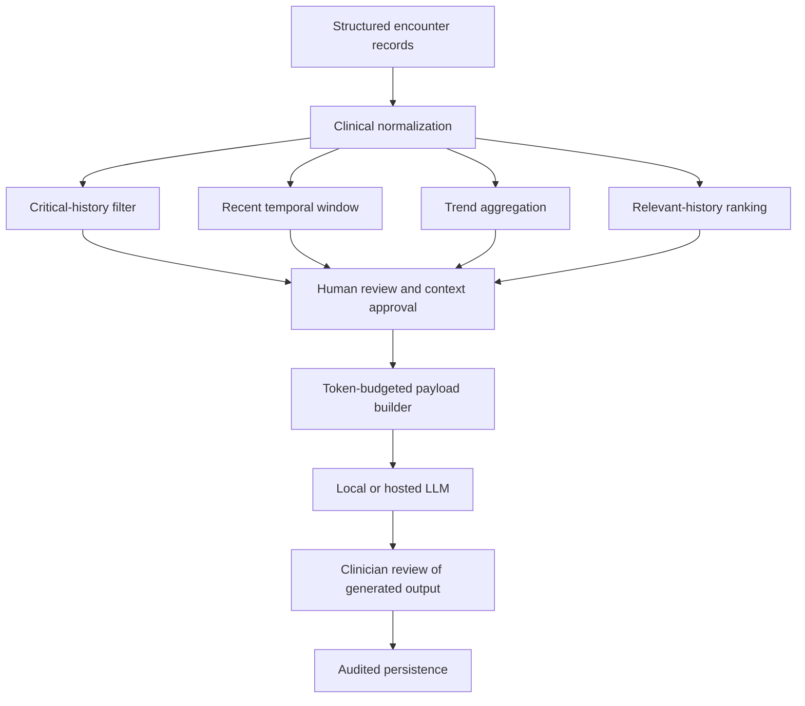
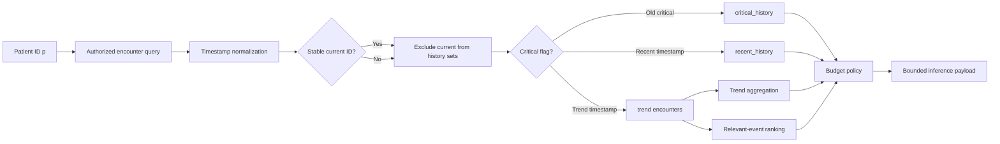

# Human-Governed Longitudinal Clinical Inference on Resource-Constrained Systems

## A Structured, Token-Budgeted Alternative to Embedding-Based Patient-History Retrieval

## Abstract

Clinical inference systems must reason over both the current presentation and the patient's longitudinal record. Sending an entire record to a language model is expensive, difficult to audit, and unreliable under constrained context windows. Conventional retrieval-augmented generation (RAG) addresses this problem through embeddings and vector search, but embedding models, vector indexes, and retrieval infrastructure can impose substantial CPU and memory costs on local or commodity hardware.

This paper presents a lightweight architecture for longitudinal clinical inference that replaces general-purpose semantic retrieval with structured temporal windowing, deterministic clinical aggregation, critical-history preservation, and human-in-the-loop context selection. Patient encounters are retained as structured, timestamped events. A context builder separates the current encounter, a detailed recent window, a compressed trend window, critical history that never expires, and ranked relevant historical events. The resulting payload is bounded by a configurable character or token budget before inference.

The architecture is designed for local inference systems that may operate without a GPU or vector database. It preserves traceability by retaining source encounter identifiers, timestamps, selection reasons, clinician edits, and omission metadata. Deterministic clinical calculations, including TEWS/SATS components, remain separate from language-model output and are not delegated to the model. The proposed system is intended to support research and clinical workflow evaluation; it is not a substitute for prospective clinical validation, institutional governance, or clinician judgment.

**Keywords:** clinical decision support, longitudinal patient history, local inference, human-in-the-loop AI, token budgeting, TEWS, SATS, retrieval, clinical auditability

## 1. Introduction

A patient's current clinical state is rarely interpretable in isolation. Prior admissions, allergies, adverse reactions, chronic disease, medication changes, mobility decline, trauma, and previous deterioration may change the meaning of today's symptoms and observations.

Large language models can synthesize these data, but clinical records create three practical constraints:

1. Longitudinal records grow beyond the model context window.
2. Raw free text is costly to transmit and difficult to prioritize safely.
3. Local deployments may not have sufficient memory or compute for embedding models and vector databases.

This paper proposes a structured alternative. Instead of asking a vector retriever to discover all relevant history, the system uses information already present in clinical workflows:

- encounter timestamps
- coded or locally normalized problem tags
- severity and criticality flags
- encounter type
- structured vitals and scores
- clinician review

The central design principle is:

> Use deterministic structure to assemble bounded clinical context, and reserve language-model inference for interpretation and synthesis.

## 2. Research Problem

Given a patient with a current encounter $e_c$, a set of historical encounters $H$, and an inference budget $B$, construct a context payload $P$ such that:

- critical safety facts are preserved
- the current encounter is represented in full
- recent deterioration remains visible
- long-term trends are represented compactly
- relevant historical events are selected explainably
- the serialized payload remains within $B$
- every included fact can be traced to a source record

Formally:

$$
P = C(e_c, H, B)
$$

where $C$ is a deterministic context-construction function. The language model receives $P$ after construction; it does not determine which records are allowed to enter the safety-critical context.

## 3. Design Goals

The architecture has six goals:

1. **Clinical safety:** critical allergies, adverse reactions, major diagnoses, and life-threatening events do not disappear because of age or token pressure.
2. **Deterministic reproducibility:** the same records, reference time, and budget produce the same payload.
3. **Resource efficiency:** routine history assembly requires indexed filtering and aggregation rather than embeddings.
4. **Human oversight:** clinicians can verify, edit, include, or exclude context before inference.
5. **Auditability:** every summary and selected event retains timestamps and source identifiers.
6. **Interoperability:** the payload can be consumed by local GGUF inference, hosted models, or a conventional RAG system.

## 4. System Architecture



The architecture has two persistent layers:

- **Raw clinical layer:** source encounters remain complete and immutable for audit and reprocessing.
- **Derived context layer:** critical-history records, trend summaries, ranking metadata, and clinician-approved context are maintained for efficient inference.

## 5. Structured Encounter Representation

Each encounter is normalized into a stable event shape. A minimal event may contain:

```json
{
  "id": "enc-123",
  "patient_id": "SYNTH-001",
  "date": "2026-08-25T10:00:00.000Z",
  "encounter_type": "triage",
  "problem_tags": ["trauma", "bleeding"],
  "diagnoses": ["traumatic injury"],
  "interventions": ["hemorrhage control"],
  "vitals": {
    "systolic_bp": 72,
    "heart_rate": 138,
    "respiratory_rate": 28,
    "temperature": 35.6,
    "avpu": "P",
    "mobility": "Immobile"
  },
  "tews": {
    "components": {
      "mobility": 2,
      "respiratory_rate": 1,
      "heart_rate": 3,
      "systolic_bp": 1,
      "temperature": 0,
      "avpu": 2,
      "trauma_modifier": 1
    },
    "total": 10,
    "priority": "red"
  },
  "trauma_present": true,
  "disposition": "ICU admission",
  "critical_flags": []
}
```

Structured fields are preferred for filtering and aggregation. Free-text notes remain available as supporting evidence but should not be the only representation of a safety-critical fact.

## 6. Critical History

Critical history is a patient-level safety layer that is independent of recent and trend windows. Its purpose is to prevent clinically important facts from expiring merely because they are old.

### 6.1 Candidate Critical Facts

Candidate facts can come from structured data, coded diagnoses, medication records, clinician flags, or carefully constrained extraction rules:

- life-threatening allergies
- severe adverse drug reactions
- major bleeding disorders
- anticoagulant use
- insulin-dependent diabetes
- epilepsy
- serious cardiac disease
- organ transplant
- severe renal or liver failure
- prior ICU admission
- major trauma with lasting consequences
- critical procedures or implants

### 6.2 Critical Record Shape

```json
{
  "type": "allergy",
  "code": "penicillin",
  "description": "Anaphylaxis to penicillin",
  "severity": "life-threatening",
  "status": "active",
  "verified": true,
  "source_encounter_ids": ["enc-123"],
  "first_observed_at": "2024-02-01T10:00:00.000Z",
  "last_confirmed_at": "2026-08-25T10:00:00.000Z",
  "never_expire": true
}
```

The critical-history filter should normalize terminology, deduplicate by code or normalized condition, preserve source links, and never remove life-threatening facts automatically.

The language model may propose a candidate critical fact, but clinician verification is required before it becomes durable critical history.

## 7. Temporal Context Windows

The context builder creates distinct windows with different fidelity levels.

### 7.1 Current Encounter

The current encounter is passed explicitly rather than inferred from the newest stored encounter. It includes full clinical detail and is never removed during budget reduction.

### 7.2 Recent Window

The recent window includes full or near-full encounters from the last configurable period, normally 24 to 72 hours. It captures:

- active deterioration
- repeated observations
- current treatments
- recent escalation or discharge
- newly documented safety facts

The current encounter is excluded from the recent-history array when it is already represented separately, preventing duplicate payload content.

### 7.3 Trend Window

The trend window covers a longer period, normally 30 to 90 days, but is represented by deterministic summaries rather than raw records. It includes:

- encounter count
- latest, highest, and average TEWS
- RED and ORANGE case counts
- vital-sign changes
- mobility sequence and transitions
- trauma frequency
- recurrent diagnoses
- repeated interventions
- admissions, discharges, and escalations

### 7.4 Relevant History

Relevant events are selected from the trend window using explainable structured signals:

```text
relevance = term_overlap * weight
          + acuity_signal
          + trauma_signal
          + disposition_signal
          + recency_signal
```

The ranking uses the explicit current encounter as its comparison target. It does not silently substitute the newest historical encounter.

### 7.5 Critical History Outside Windows

Critical events older than the trend window are placed in a separate `critical_history` bucket. This bucket bypasses normal time cutoffs and is preserved before ordinary history during budget enforcement.

## 8. Human-in-the-Loop Context Stuffing

Human-in-the-loop context stuffing means that a clinician reviews the assembled context before it is sent to the inference model.

```text
Raw encounters
    -> deterministic critical-history filter
    -> temporal windows and trend summaries
    -> clinician review, correction, and selection
    -> token-budgeted context
    -> model inference
    -> clinician review of output
    -> audited persistence
```

The review interface should allow the clinician to:

- confirm or reject critical-history candidates
- correct mobility, trauma, medication, and severity fields
- select relevant encounters
- exclude irrelevant encounters
- inspect source encounter IDs and timestamps
- see which facts were omitted because of the budget
- approve the final AI output before it becomes an official record

Three audit layers should remain distinct:

1. Raw source history
2. Clinician-curated inference context
3. Generated model output

This separation prevents an AI suggestion from being mistaken for an original clinical fact.

## 9. Token-Budgeted Payload Construction

The payload builder receives a hard character or token budget. A practical allocation for an ample budget is:

| Section | Approximate allocation |
|---|---:|
| Current encounter | 35% |
| Recent history | 25% |
| Trend summary | 20% |
| Relevant history | 15% |
| Instructions and output schema | 5% |

The allocation is adaptive. When the available budget is smaller, the system reduces the recent time horizon, relevant-event count, and trend-array limits before inference.

Example profiles:

| Budget | Recent window | Relevant events | Summary items |
|---:|---:|---:|---:|
| 12,000 characters or more | 72 hours | 5 | 20 |
| 6,000-11,999 | 48 hours | 3 | 15 |
| 3,000-5,999 | 24 hours | 2 | 10 |
| Under 3,000 | 12 hours | 1 | 5 |

Budget reduction order:

1. Remove duplicate notes and repeated measurements.
2. Remove lower-ranked relevant events.
3. Reduce recent-history events while retaining the current encounter.
4. Reduce non-critical summary arrays.
5. Preserve all critical history and current safety data.
6. Report honestly when the irreducible payload still exceeds the configured budget.

The system must not claim that a payload fits when it does not. Metadata should include `truncated`, `budget_note`, and the selected budget profile.

## 10. Deterministic TEWS/SATS Processing

TEWS/SATS scoring is performed outside the language model. The model receives the calculated components and result as authoritative structured data.

The following concepts must remain separate:

- TEWS total: numeric points
- SATS priority: RED, ORANGE, YELLOW, or GREEN
- mobility score: mobility component
- trauma modifier: explicit additional score
- nurse override: deliberate clinical decision

For a synthetic adult trauma case:

```text
Mobility, Immobile:       +2
Respiratory rate, 28:     +1
Heart rate, 138:          +3
Systolic BP, 72:          +1
Temperature, 35.6:        +0
AVPU, Pain:               +2
Trauma modifier:          +1
--------------------------------
TEWS total:                10
SATS priority:             RED
```

The component values and total should be persisted together so downstream confirmation and official reports cannot substitute a stale urgency field for the authoritative TEWS total.

## 11. Experimental Timestamped History Algorithm

This section defines an experimental algorithm for collecting patient history over timestamped windows and preparing it for bounded LLM inference. It is intended for simulation, unit testing, and architecture evaluation. It is not a clinically validated protocol.

### 11.1 Variables

Let:

- $p$ be the patient identifier.
- $e_c$ be the explicitly supplied current encounter.
- $H_p = \{e_1, e_2, \ldots, e_n\}$ be all stored encounters for patient $p$.
- $t_0$ be the reference time at which the inference request is created.
- $R$ be the recent-window duration in hours.
- $D$ be the trend-window duration in days.
- $B$ be the maximum serialized context budget in characters or estimated tokens.
- $C_p$ be the patient's persistent critical-history set.
- $\tau_R = t_0 - R$ be the recent-window cutoff.
- $\tau_D = t_0 - D$ be the trend-window cutoff.

Each encounter has a normalized timestamp $t(e)$ and a stable identifier $id(e)$.

The windows are defined as:

$$
W_{recent} = \{e \in H_p : \tau_R \leq t(e) \leq t_0\}
$$

$$
W_{trend} = \{e \in H_p : \tau_D \leq t(e) < \tau_R\}
$$

$$
W_{critical} = \{e \in H_p : critical(e) = 1 \land t(e) < \tau_D\}
$$

The current encounter is removed from historical sets when it is already present in storage:

$$
H'_p = \{e \in H_p : id(e) \neq id(e_c)\}
$$

This prevents the same event from being sent both as `current_encounter` and as a recent historical event.

### 11.2 Critical-History Variable

Critical history is represented separately from ordinary time windows:

$$
C_p = \{f_1, f_2, \ldots, f_m\}
$$

where each fact $f_i$ contains:

```json
{
  "fact_id": "critical-001",
  "patient_id": "SYNTH-001",
  "type": "allergy",
  "description": "Penicillin anaphylaxis",
  "severity": "life-threatening",
  "status": "active",
  "verified": true,
  "source_encounter_ids": ["enc-123"],
  "first_observed_at": "2024-02-01T10:00:00.000Z",
  "last_confirmed_at": "2026-08-27T09:00:00.000Z",
  "never_expire": true
}
```

The critical-history set is updated at encounter write time and is not discarded when an encounter becomes older than the trend window. Candidate facts require conservative extraction and clinician verification before becoming durable safety facts.

### 11.3 Event-Count Accounting

The algorithm exposes counts for every history class:

$$
N_{all} = |H_p|
$$

$$
N_{recent} = |W_{recent}|
$$

$$
N_{trend} = |W_{trend}|
$$

$$
N_{critical} = |W_{critical}|
$$

$$
N_{relevant} = |W_{relevant}|
$$

The counts refer to encounter events, not the number of facts inside each event. A single encounter may contain multiple diagnoses, observations, interventions, or critical facts.

### 11.4 Collection Algorithm

```text
INPUT: patient p, current encounter ec, reference time t0, budget B

1. Load all authorized encounters for p.
2. Normalize and validate every encounter timestamp.
3. Exclude ec from historical collections by stable ID.
4. Identify critical facts and critical encounters.
5. Build the recent window using [t0 - R, t0].
6. Build the trend window using [t0 - D, t0 - R).
7. Aggregate trend statistics from the trend window.
8. Rank relevant events against ec using structured clinical terms.
9. Estimate serialized size for current, critical, recent, trend, and relevant sections.
10. Reduce ordinary history according to the budget policy.
11. Preserve current encounter and critical history.
12. Emit payload counts, date boundaries, budget metadata, and source IDs.
```

### 11.5 Mermaid Data-Collection Diagram



## 12. Mathematical Context-Budget Model

### 12.1 Token or Character Cost

Let $\ell(x)$ be the serialized size of object $x$. Depending on the implementation, $\ell$ may count characters or estimated model tokens.

The total payload cost is:

$$
L(P) = \ell(e_c) + \ell(C_p) + \ell(W_{recent}) + \ell(S_{trend}) + \ell(W_{relevant}) + \ell(I)
$$

where:

- $e_c$ is the current encounter
- $C_p$ is critical history
- $W_{recent}$ is detailed recent history
- $S_{trend}$ is the compressed trend summary
- $W_{relevant}$ is ranked relevant history
- $I$ is the instruction and output-schema section

The budget requirement is:

$$
L(P) \leq B
$$

If the irreducible current and critical sections alone exceed $B$, the algorithm must report the overflow rather than silently discard safety information:

$$
L_{irreducible} = \ell(e_c) + \ell(C_p) + \ell(I)
$$

$$
overflow = \max(0, L_{irreducible} - B)
$$

### 12.2 Budget Allocation

For an ample budget, define allocation fractions:

$$
\alpha_c + \alpha_r + \alpha_t + \alpha_h + \alpha_i = 1
$$

with a practical allocation:

```text
alpha_current  = 0.35
alpha_recent   = 0.25
alpha_trend    = 0.20
alpha_relevant = 0.15
alpha_instructions = 0.05
```

The nominal section budgets are:

$$
B_k = \alpha_k B
$$

Critical history is protected as a priority reservation and should be accounted for before ordinary-history allocation:

$$
B_{ordinary} = \max(0, B - \ell(e_c) - \ell(C_p) - \ell(I))
$$

The ordinary budget is then divided between recent, trend, and relevant sections.

### 12.3 Adaptive Budget Profiles

The experimental implementation uses budget profiles to reduce the amount of history assembled before final trimming:

| Maximum budget | Recent window | Relevant events | Summary items |
|---:|---:|---:|---:|
| $B \geq 12{,}000$ | 72 hours | 5 | 20 |
| $6{,}000 \leq B < 12{,}000$ | 48 hours | 3 | 15 |
| $3{,}000 \leq B < 6{,}000$ | 24 hours | 2 | 10 |
| $B < 3{,}000$ | 12 hours | 1 | 5 |

The trend horizon may remain 90 days while its representation becomes more compact. This preserves long-term signal without sending every historical encounter.

### 12.4 Utility-Based Event Selection

For an ordinary event $e$, define a deterministic utility score:

$$
U(e) = w_m M(e,e_c) + w_s S(e) + w_t T(e) + w_d D(e) + w_r R(e)
$$

where:

- $M$ is structured term overlap with the current encounter
- $S$ is severity or TEWS signal
- $T$ is trauma relevance
- $D$ is disposition significance
- $R$ is recency
- $w_m, w_s, w_t, w_d, w_r$ are configured weights

Relevant history is selected by descending $U(e)$ subject to the relevant-event count and remaining budget.

## 13. Model-Facing Payload Contract

The final payload should expose both data and accounting metadata:

```json
{
  "current_encounter": {},
  "critical_history": [],
  "recent_history": [],
  "historical_summary": {},
  "relevant_history": [],
  "metadata": {
    "as_of": "2026-08-27T12:00:00.000Z",
    "recent_window_hours": 72,
    "trend_window_days": 90,
    "total_source_encounters": 18,
    "recent_encounter_count": 2,
    "trend_encounter_count": 13,
    "critical_encounter_count": 3,
    "relevant_encounter_count": 4,
    "max_budget": 12000,
    "estimated_characters": 10840,
    "estimated_tokens": 2900,
    "budget_profile": "ample",
    "truncated": false,
    "source_encounter_ids": ["enc-current", "enc-001", "enc-002"],
    "omitted_due_to_budget": 7
  }
}
```

The payload should make it possible to answer:

- how many source encounters were considered?
- which encounters were selected?
- which critical facts were included?
- what time range does each section represent?
- how much context was sent?
- what was omitted because of the budget?

## 14. Experimental Evaluation Procedure

The algorithm should first be evaluated without asking the LLM to make a clinical decision.

### 14.1 Synthetic Input

Generate encounters across controlled timestamp bands:

```text
current encounter: 2026-08-27 10:00 UTC
recent encounter:  2026-08-26 08:00 UTC
trend encounter:   2026-07-15 08:00 UTC
critical event:    2024-02-01 10:00 UTC
excluded event:    2023-01-01 10:00 UTC
```

### 14.2 Assertions

Verify that:

1. the current encounter is represented exactly once;
2. recent encounters satisfy the recent timestamp range;
3. trend encounters exclude recent events;
4. old critical history survives both time cutoffs;
5. invalid dates are counted and reported;
6. TEWS, mobility, trauma, and priority fields remain structured;
7. the payload reports source-event counts;
8. ordinary history is reduced when the budget is tight;
9. current and critical history are retained during truncation;
10. the serialized payload reports truthful size and omission metadata.

### 14.3 Model Evaluation

Only after the collection algorithm passes deterministic tests should the payload be sent to the LLM. Compare:

- model output with and without longitudinal context
- model output with ample and tight budgets
- valid versus malformed JSON responses
- deterministic TEWS/SATS result versus generated ESI result
- clinician-approved context versus automatically selected context

The model must not be allowed to overwrite deterministic safety calculations when its output is malformed or contradictory.

## 15. Implementation Strategy

### 11.1 Write-Time Processing

At encounter creation:

1. Normalize the encounter shape.
2. Normalize mobility and trauma values.
3. Calculate and persist TEWS components and total.
4. Extract candidate critical facts.
5. Merge verified critical facts into patient-level history.
6. Update rolling summaries for affected problem tags.
7. Preserve source encounter identifiers.

### 11.2 Read-Time Processing

At inference request time:

1. Load patient-scoped records with authorization and hospital-tenancy filters.
2. Construct the current, recent, trend, critical, and relevant sections.
3. Apply the budget profile.
4. Run clinician context review where required by policy.
5. Serialize the bounded payload.
6. Send it to the LLM endpoint.
7. Validate the response schema.
8. Persist the model result separately from source and curated context.

### 11.3 Suggested API Boundaries

```text
GET  /patients/:id/history/summary
GET  /patients/:id/history/recent
GET  /patients/:id/history/trends
GET  /patients/:id/history/relevant
GET  /patients/:id/critical-history
POST /patients/:id/critical-history/candidates/:candidateId/verify
POST /patients/:id/inference-context/preview
POST /patients/:id/inference-context/approve
```

The preview endpoint should expose exactly what will be sent to the model before inference.

## 16. Evaluation Protocol

The architecture should be evaluated independently of model quality first.

### 12.1 Windowing Tests

Test:

- recent-window boundaries
- trend-window boundaries
- encounters exactly on cutoff times
- invalid timestamps
- current encounter not present in stored history
- current encounter duplicated in stored history
- critical events older than 90 days

### 12.2 Summary Tests

Test:

- TEWS averages and maxima
- RED and ORANGE counts
- vital trends
- mobility transitions
- trauma frequency
- diagnosis and intervention deduplication
- explicit priority overrides

### 12.3 Budget Tests

Test:

- ample budgets
- tight budgets
- minimal budgets
- critical history preservation
- current encounter preservation
- truthful truncation metadata
- bounded serialized output

### 12.4 Model-Interface Tests

Test:

- longitudinal context reaches the Python endpoint
- structured history is merged into the intended history variable
- mobility and trauma values survive serialization
- invalid model JSON cannot overwrite deterministic safety fields
- fallback output contains the exact TEWS components
- model-generated ESI remains distinguishable from deterministic TEWS/SATS priority

### 12.5 Human-Factors Tests

Measure:

- clinician time to approve a context
- rate of critical-fact correction
- rate of irrelevant-history exclusion
- omission visibility
- agreement between curated context and final report
- clinician trust and perceived workload

## 17. Failure Modes and Safeguards

### Missing or Invalid Dates

Invalid dates should be counted and reported rather than silently disappearing.

### Summary Drift

Rolling summaries should periodically be re-anchored against raw encounters. Summarizing summaries indefinitely can accumulate errors.

### Criticality Errors

The critical-history filter is a safety mechanism, not a diagnosis engine. Candidate extraction should be conservative, source-linked, and subject to clinician verification.

### Invalid LLM Output

If the model returns prose, malformed JSON, or incomplete required fields:

- mark the output invalid
- preserve the deterministic TEWS/SATS result
- return an explicit fallback reason
- do not treat arbitrary generated text as an official clinical report

### Field Confusion

The implementation must never use numeric `urgencyScore` as a substitute for either TEWS total or SATS priority. Field names should be explicit and validated at API boundaries.

### Authorization

History retrieval must enforce patient identity, hospital tenancy, role permissions, and audit logging before context construction.

## 18. Limitations

This architecture does not prove clinical effectiveness. It reduces infrastructure cost and improves traceability, but several limitations remain:

- structured tagging quality becomes a major source of retrieval error
- rule-based relevance may miss semantically related events
- clinical summaries can drift without periodic re-anchoring
- character budgets are only approximations of model token budgets
- local inference quality depends on model, quantization, and available memory
- human review introduces workflow time and requires careful interface design
- prospective safety and outcome studies are required before clinical deployment

## 19. Reproducibility

A reproducible experiment should record:

- patient identifier, pseudonymized for research
- reference timestamp
- recent-window duration
- trend-window duration
- budget profile and maximum size
- source encounter IDs
- critical-history candidates and verification state
- serialized inference payload hash
- model name and quantization
- inference mode and hardware profile
- response-validation result
- fallback reason, if any

A synthetic test case should be used for development and regression testing before real patient data is introduced.

## 20. Conclusion

Longitudinal clinical context does not inherently require a vector database. For structured, timestamped patient records, temporal indexing, deterministic aggregation, critical-history preservation, and clinician review can provide a lower-cost and more auditable foundation for local clinical inference.

The proposed architecture makes an explicit separation between:

- what happened in the source record
- what the system selected for context
- what the clinician approved
- what the model generated
- what deterministic safety rules calculated

That separation is the central safety property. It allows local language models to contribute clinical synthesis without allowing limited context windows, opaque retrieval, or malformed model output to erase critical history or overwrite authoritative scoring.

## References and Further Reading

1. South African Triage Scale and TEWS guidance. The project implementation uses the supplied SATS/TEWS reference chart as the operational scoring source.
2. Longitudinal patient-history payload design and synthetic evaluation notes: `LONGITUDINAL_PATIENT_HISTORY_PAYLOADS.md`.
3. Project architecture and hardware adaptation notes: `ARCHITECTURE.md` and `AUTO_CONFIG_ARCHITECTURE.md`.
4. Research background on triage and emergency severity assessment: [PMC7058878](https://pmc.ncbi.nlm.nih.gov/articles/PMC7058878/).

## Research Ethics Notice

This document describes a software architecture and evaluation plan. It does not establish clinical validity, diagnostic performance, or regulatory approval. Any use with real patient data requires institutional review, privacy controls, clinical governance, prospective validation, and compliance with applicable health-information regulations.
