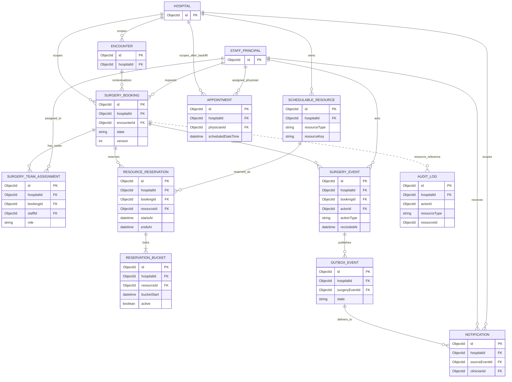

# User-Scoped Calendar, Event Tracking, and Surgery Scheduling Plan

## Purpose and scope

Build a reliable calendar and operational event experience where each signed-in staff member sees the schedule, work items, alerts, and metric cards appropriate to their identity, role, specialty, department, assignments, and hospital. The calendar must support planned surgeries and meetings as well as time-relevant medication, radiology, pathology, and research work without treating every record as the same kind of appointment.

This document is a plan only. No application behavior or schemas are changed by this document.

The work should be delivered and QA'd in small phases. Synthetic data only is used until the complete role, authorization, persistence, alert, and recovery gates pass.

### Assurance matrix conventions

The detailed rules, role mappings, targets, thresholds, control references, and owners introduced below are **proposed** until an accountable owner approves them. Record each as Approved, Deferred, or Rejected; an unowned or undated decision is a blocker, not an implicit default. Any item not explicitly allowed is hidden, disabled, or rejected by default.

Use stable IDs for decision records (`D-*`), transitions (`T-*`), hazards (`H-*`), requirements (`R-*`), and tests (`TS-*`). Proposed role names must be mapped to the existing position, system-role, and shift `assignmentRole` catalog. ISO/IEC 27001:2022 Annex A references in this plan are orientation only; verify references against the applicable edition and approved organizational SoA before making compliance claims.

## Product and safety rules

1. **The authenticated user and hospital are authoritative.** The server derives identity and tenant scope from the verified session. A browser-supplied user, role, recipient, or hospital ID is never sufficient authorization.
2. **Personal calendars are genuinely personal.** A user sees assigned events and explicitly permitted team/department events. Hospital-wide visibility is not the default.
3. **Role controls action, not just appearance.** UI affordances are role-aware, and every read, mutation, metric, and notification recipient is independently authorized on the server.
4. **The domain record is the source of truth.** Calendar tiles and metric cards are projections of persisted surgery, appointment, order, study, specimen, meeting, or research records and their lifecycle history.
5. **Scheduling is not completion.** Scheduled, arrived, started, completed, cancelled, postponed, no-show, and aborted are distinct facts with distinct timestamps and metrics.
6. **Persist before delivery.** A failed notification delivery must not remove or roll back the underlying event or state transition. Delivery and retry state must remain visible.
7. **No fabricated success.** API, authorization, or network failure must show an explicit error or stale-data state. It must not silently replace live events with sample records.
8. **Patient information is minimized.** Calendar summaries reveal only the patient details permitted for that role and assignment. Administrative aggregate metrics should not expose patient details by default.
9. **Every lifecycle change is attributable and auditable.** Record actor, effective role/context, hospital, resource, action, before/after state, reason, timestamp, and correlation/event ID.
10. **Refresh, navigation, and re-login are part of correctness.** In-memory UI state is not evidence that scheduling, alerting, or audit persistence succeeded.

## Assurance, standards, and regulatory applicability

This plan is intended to make requirements and evidence traceable; it does not certify the organization, product, or software and cannot guarantee that no defects remain. ISO management-system certification is an organization-level process assessed by an accredited certification body. Product compliance, clinical safety, and regulatory status require separate qualified assessment.

Before selecting controls or making compliance claims, the organization must document its intended use, deployment model, data flows, operating jurisdictions, customers, and whether the software's intended function qualifies it as a medical device or otherwise regulated clinical software. Obtain qualified privacy, security, clinical-safety, and regulatory advice. Do not assume that scheduling is outside medical-device regulation or that critical alerts automatically make it a device; the determination depends on intended use and jurisdiction.

| Candidate reference | Applicability question | Planning treatment |
|---|---|---|
| ISO/IEC 27001 and ISO/IEC 27002 | Is an organization-wide information security management system (ISMS) and control framework in scope? | Map applicable controls to the organization's risk assessment and Statement of Applicability (SoA); retain implementation evidence and justified exclusions. |
| ISO/IEC 27701 | Does the organization need a privacy information management extension to its ISMS? | Have privacy counsel/management determine applicability, controller/processor roles, and the current certification route. |
| ISO 27799 | Is health-informatics-specific security guidance useful for the healthcare deployment? | Treat as sector guidance; do not describe it as a standalone certificate without independent confirmation. |
| ISO 9001 | Is organization-wide quality management certification a business objective? | Plan document control, competence, internal audit, corrective action, and management review at organization scope. |
| ISO 13485, IEC 62304, ISO 14971, IEC 62366-1 | Does intended use and jurisdiction classify this product or feature as medical-device software? | Obtain and record a formal regulatory determination before finalizing lifecycle, risk, usability, verification, and release obligations. Apply only as advised for the applicable jurisdiction and product classification. |
| ISO 8601 and HL7 FHIR Schedule/Slot/Appointment concepts | Are interoperable timestamps or healthcare schedule integrations required? | Use as design references where appropriate; these are not product certifications. Define profile/version and conformance testing if interoperability is in scope. |
| Privacy and health-data laws (for example POPIA, GDPR, or HIPAA) | Which laws apply based on jurisdiction, data subjects, organization role, and service model? | Have qualified counsel identify obligations; record the applicable law and required privacy/security artifacts. Do not infer applicability from this example list. |

### Organization-level artifacts and responsibilities

The organization, not this application plan alone, owns the following evidence where required by its selected scope:

- approved scope statement, system/context boundary, asset and data-flow inventories, and regulatory determination;
- information-security risk assessment/register and SoA, including implementation status, exclusions, rationale, control owner, and evidence reference;
- calendar/surgery hazard analysis with severity, likelihood, risk control, residual risk, verification, and accountable owner;
- controlled security, privacy, access-review, change/release, incident/breach response, backup/restore, business-continuity, supplier, retention/deletion, and secure-development procedures;
- privacy impact assessment and data-subject rights/breach processes when required by applicable law;
- if medical-device software obligations apply: safety classification, software requirements/architecture/lifecycle records, SOUP and dependency inventory, anomaly handling, verification/validation, usability evidence, and release records;
- staff competence/training records, internal audit schedule and results, management review, nonconformities, corrective actions, and external audit evidence.

Each artifact needs an owner, approver, version, review date, retention rule, and controlled location. This repository plan can link to those records but must not contain credentials, real patient data, or sensitive audit evidence.

## Current-state findings

The following observations were verified in the current repository:

- `App.jsx` maps `/calendar` directly to `CalendarPage`; that route is not mounted inside `SidebarLayout`. This explains why the shared sidebar is missing on the calendar page.
- `CalendarPage.jsx` requests `/api/calendar/events`, polls every 10 seconds, and substitutes a set of sample events after a request failure. That fallback can make a broken or unauthorized calendar appear populated and must be removed before alert-critical QA.
- `calendar.controller.js` scopes encounter searches to `req.hospitalId`, but it currently builds encounter-derived events for the hospital without first restricting those encounters to the signed-in user's assignments or role permissions. The separate appointment query is filtered by the current physician ID. This is not yet a complete per-user authorization model.
- The calendar API currently combines surgery, lab, medication, administration, diagnosis, discharge, handover, and appointment data. Several records are represented as calendar events using their creation/request timestamps; those must not be confused with a planned appointment or an actual procedure slot.
- `ScheduledSurgeriesPage.jsx` reads the physician surgery endpoint, can create a surgery record, polls every 10 seconds, and also supplies sample surgeries on request failure. Its schedule form does not capture an operating theatre or team roster.
- Surgery records are currently embedded under `Encounter.surgery_records`. The schema has a schedule timestamp, surgeon, priority, status, and performed timestamp, but not a full append-only transition history or the complete scheduled-versus-actual lifecycle contract.
- `Notification` is hospital-scoped and recipient-scoped, but requires `encounter_id` and is shaped around clinical handover notifications. It does not yet provide a general schedule-event delivery contract for meetings, research work, or other non-encounter events.
- `DIAGNOSIS_STATISTICS_USER_JOURNEY_ROADMAP.md` requires role-aware state, authoritative persistence, audit evidence, refresh safety, and hospital isolation. It also calls out event-model and alert-latency decisions as approval-dependent.
- `DIAGNOSIS_STATISTICS_INTEGRATION_PLAN.md` already specifies event-backed specialist telemetry, persisted notification delivery, distinct surgery and appointment lifecycles, and cross-surface consistency gates. This plan extends those requirements into the user's calendar journey rather than creating duplicate workflows.

## Risk and requirement traceability

Maintain a controlled traceability register before implementation. Each requirement must link through:

**Requirement → hazard/risk → approved control/reference → design element → verification test → evidence artifact → accountable owner**

No safety, privacy, security, persistence, alert, or metric requirement is implementation-complete if it lacks an objective test and retained evidence. No control is complete if its owner, operating procedure, and evidence are undefined. A requirement without a control or test is a visible gap, not an implicit pass.

The register should include a stable requirement ID; source and rationale; affected user/workflow; risk and severity; control objective and applicable standard/regulation mapping; implementation/design references; automated/manual test ID; evidence location and retention; owner/approver; status; and approved residual-risk decision. The SoA is maintained at organization scope and is not replaced by this feature-level register.

### Initial calendar and surgery hazard register

These are starter hazards, not a complete clinical risk analysis. Qualified clinical-safety and security reviewers must assess severity, likelihood, detectability, mitigations, residual risk, and release acceptability in the organization's risk system.

| ID | Hazard | Example harm or impact | Required control direction | Verification evidence |
|---|---|---|---|---|
| H01 | Critical alert is missed, delayed, or routed to the wrong role | Delayed clinical response | Persist event before delivery; resolve recipients from authoritative assignment/escalation policy; retry and escalate; display delivery/acknowledgement state | Inject delivery failures and wrong-recipient cases; prove durable event, correct recipient, escalation timing, and audit trail |
| H02 | Theatre, surgeon, or required resource is double-booked | Delayed/cancelled care or unsafe preparation | Recheck availability atomically at commit; model resource constraints and conflicts; return explicit conflict rather than silently overwrite | Concurrent overlap/property tests and database-level conflict evidence |
| H03 | Wrong patient or encounter is attached to an event | Misrouted work or disclosure | Verify patient/encounter/hospital relationship server-side; show stable permitted identifiers; audit linkage corrections | Mismatched and cross-hospital identifier tests; verify rejection and audit |
| H04 | Stale calendar is presented as current/live | Missed change, duplicate work, or invalid action | Expose freshness and stale state; revalidate current status and authorization before mutation; never use sample fallback as live data | API outage/stale-state test, action-after-stale conflict test, and UI/API evidence |
| H05 | Cross-user or cross-hospital event/metric leakage | Privacy breach and unauthorized action | Enforce principal, role/assignment, and tenant predicates before projection and aggregation; reauthorize detail/actions | Tampered request and adversarial role/tenant matrix in CI; verify payload, metrics, and audit |
| H06 | Reschedule/cancellation leaves an obsolete reminder active | Staff act on an invalid time or cancelled task | Supersede/cancel old reminder and notify authorized original recipients; deduplicate by transition | Reschedule/cancel with delayed/retried delivery; prove old reminder is inactive and new state is visible |
| H07 | A scheduled or no-show surgery is counted as completed | Misleading performance or operational decision | Derive metrics from explicit lifecycle transitions and completion evidence; keep exceptions separate | Reconciliation tests against authoritative records and metric denominators |
| H08 | Time-zone or DST error shows the wrong surgery time | Staff attend or prepare at the wrong time | Store UTC and hospital IANA zone; require explicit offset for ambiguous local times | DST-boundary and cross-zone viewer tests |
| H09 | Notification reaches staff whose assignment ended | Unauthorized disclosure or action | Re-resolve recipients at delivery/open; enforce assignment windows and revocation | Shift-end and role-revocation tests |
| H10 | Audit log is tampered with or incomplete | Loss of evidence or undetected unauthorized action | Append-only storage, integrity checks, write-failure alarm, restricted access | Tamper-detection and failed-write tests |
| H11 | Clock skew reorders recorded events | Incorrect lifecycle/alert ordering | Use server time for recorded facts; monitor clock synchronization | Clock-skew injection and monitoring evidence |
| H12 | Break-glass is misused | Excessive clinical-data access | If approved: reason, time limit, one-patient scope, privacy-owner notice, mandatory review | Misuse and expiry tests; disabled-state test before approval |
| H13 | Reassignment is not communicated | Missed surgery or stale responsibility | Reassignment transition notifies both parties and supersedes old reminders | Assignment swap with delivery-failure test |
| H14 | Free/busy or low-count aggregates re-identify patients | Privacy disclosure through inference | Omit identifiers; suppress low counts with complementary suppression | Differencing and low-count tests |
| H15 | Migrated legacy record appears to have complete history | False assurance about prior decisions | Mark `LEGACY_INCOMPLETE_HISTORY`; do not synthesize transitions | Migration reconciliation and detail-view tests |
| H16 | Scheduler works from an opaque patient reference and books or changes the wrong booking | Wrong slot or delayed/cancelled care | Show booking ID, priority, requested window, and procedure label if D-07 permits; require explicit confirmation naming the booking ID before scheduler transitions; validate against the stored request | Wrong-booking and near-duplicate-booking tests; confirmation-bypass test; audit shows booking ID |
| H17 | Missing or wrong `arrivedAt` causes a false no-show or a start without the patient present | Cancelled care or unsafe start | Name and audit the recording actor (AR01); allow correction only by amendment; reject T06/T11 when `arrivedAt` exists; require it for T08 | Arrival-missing, arrival-after-no-show, and correction tests |
| H18 | Slot change loses the slot or double-books it | Delayed or cancelled care | Release and reservation in one transaction; 409 on conflict keeps the old slot held; expected-version check | Concurrent slot-change and conflict tests; verify old slot held on failure |
| H19 | Duplicate or conflicting open booking requests for the same procedure | Double scheduling or wasted theatre time | Reject a duplicate open request for the same patient, encounter, and procedure; scheduler sees requests with booking IDs | Duplicate-request and retry tests |

Review hazards when requirements, workflows, recipients, third-party services, or regulatory assumptions change. A release must have an explicit residual-risk acceptance by the designated accountable owner; unresolved unacceptable risk blocks release.

### Starter traceability matrix

The following links are proposed traceability starters. Candidate Annex A references are for orientation only and must be checked against the selected edition and SoA; they do not establish conformity.

| Req ID | Requirement | Hazard | Candidate control reference | Test ID | Evidence | Owner role |
|---|---|---|---|---|---|---|
| R-01 | Identity and hospital derive only from verified session | H05 | A.5.15 Access control; A.8.3 Information access restriction | TS-P0-04, TS-AUTH-* | CI report and sanitized payload samples | Security lead |
| R-02 | Event/metric reads enforce user, assignment, hospital scope | H05, H09 | A.5.18 Access rights; A.8.3 | TS-AUTH-P0-MATRIX | Backend CI report from `calendar.controller.test.js` using synthetic IDs | Security lead |
| R-03 | No sample data on failure | H04 | A.8.28 Secure coding | TS-P0-05 | Test report and review | Engineering lead |
| R-04 | Transition table is one policy source | H07 | A.8.25 Secure development lifecycle | TS-TRN-* generated | Policy version and test run | Clinical and engineering leads |
| R-05 | No overlapping exclusive-resource bookings | H02 | A.8.29 Security testing in development | TS-CONC-* | Concurrency run and database constraint evidence | Engineering lead |
| R-06 | Transition, event, and outbox are atomic/idempotent | H01, H06 | Confirm applicable controls through risk assessment/SoA | TS-OUT-*, TS-IDEM-* | Run logs and audit samples | Engineering lead |
| R-07 | Lifecycle audit includes actor, context, before/after, reason | H10 | A.8.15 Logging; A.5.28 Collection of evidence | TS-AUD-* | Sanitized audit sample and integrity check | Security lead |
| R-08 | Patient-identifying reads are logged | H05, H12 | A.8.15; A.5.34 Privacy and PII protection | TS-RLOG-* | Restricted log sample | Privacy owner |
| R-09 | Aggregates suppress small counts | H14 | A.8.11 Data masking; A.5.34 | TS-AGG-* | Metric reconciliation | Privacy owner |
| R-10 | Notifications are durable, deduplicated, retryable | H01, H06 | A.8.16 Monitoring | TS-NTF-* | Delivery-attempt records | Engineering lead |
| R-11 | Hospital zone and DST rules are enforced | H08 | Confirm applicable control through risk assessment/SoA | TS-TIME-* | Test report | Engineering lead |
| R-12 | Calendar/metrics use consistent snapshot and freshness | H04 | Confirm applicable control through risk assessment/SoA | TS-SNAP-* | Paired payload comparison | Engineering lead |
| R-13 | Clock synchronization is monitored | H11 | A.8.17 Clock synchronization | TS-CLK-* | Monitoring export | Operations lead |
| R-14 | Backups restore within approved RTO/RPO | All | A.8.13 Information backup | TS-REC-* | Restore test record | Operations lead |
| R-15 | Test data is synthetic and protected | H05 | A.8.33 Test information | TS-DATA-* | Dataset provenance | Privacy owner |
| R-16 | Dependencies are scanned and SBOM retained | - | A.8.8 Technical vulnerability management | TS-SCA-* | Scan and SBOM per release | Security lead |
| R-17 | Lifecycle and audit history retention, legal hold, and amendment-only corrections | H10, H15 | A.5.33 Protection of records (verify edition); A.8.15 | TS-RET-* | Retention policy record and deletion-test evidence | Privacy owner |
| R-18 | Scheduler sees only the minimum dataset | H05, H16 | A.8.3; A.5.34 | TS-SCHED-* | Scheduler-role payload samples | Privacy owner |
| R-19 | Roster-based transition authorization for surgeon and theatre / pre-op lead | H05, H16 | A.5.15; A.5.18 | TS-ROSTER-* (generated matrix) | Matrix run record | Security lead |
| R-20 | Arrival recording is attributed, audited, and correctable only by amendment | H17 | A.8.15 | TS-ARR-* | Sanitized audit sample | Clinical lead |
| R-21 | Slot change is atomic and keeps the old slot on conflict | H02, H06, H18 | A.8.15 Logging; confirm further controls through risk assessment/SoA | TS-SLOT-* | Concurrency run and audit sample | Engineering lead |
| R-22 | Booking creation validates patient, encounter, hospital, requester, and duplicates | H03, H19 | A.5.15; A.5.18 | TS-CREATE-* | Test report and audit sample | Security lead |

Any requirement without a test ID or evidence location remains an explicit gap.

H02 and H07 are clinical-safety and data-integrity hazards controlled through the organization's hazard analysis (and ISO 14971 where it applies). The Annex A references in those rows are orientation only and do not claim that the listed control mitigates the hazard.

Only the TS-P0-* tests are fully defined in this plan. Each other referenced family (AUTH, TRN, CONC, OUT, IDEM, AUD, RLOG, AGG, NTF, TIME, SNAP, CLK, REC, DATA, SCA, RET, SCHED, ROSTER, ARR, SLOT, CREATE) must be written as a named specification with preconditions, steps, expected result, and evidence before the phase that depends on it can exit. An undefined test ID is a gap, not a pass.

## Target user journey

1. The user signs in and opens the calendar from their authorized workspace.
2. The shared `SidebarLayout` remains available, and the calendar header identifies the current user's role/context and hospital without exposing another user's data.
3. The server resolves the authenticated user, hospital, effective duty/assignment, specialty, department, and permitted visibility scope.
4. The user sees the default date range, relevant calendar events, role-specific metric cards, and actionable alerts. Empty, loading, stale, and error states are distinct.
5. The user filters by event category, status, priority, department, and date range only within their authorization scope.
6. The user opens an event to see an authorized detail view and permitted actions. Scheduling actions use the relevant domain workflow; the calendar does not create a second source of truth.
7. A save is acknowledged only after the domain state and its audit/event history have persisted. The resulting notification is linked to that persisted transition.
8. On refresh, route change, or a fresh login, the same authorized state is reconstructed from the backend. A different user signing in sees their own view and metrics.

## Identity, role, and visibility contract

### Context resolution

Use the authenticated identity plus the existing staff-position, system-role, shift-assignment, specialty, department, and hospital records. Preserve the existing distinction between job position, broad system role, and shift `assignmentRole`. A selected calendar view or user-controlled filter can narrow authorized results but cannot broaden them.

The backend must calculate the effective read/action scope for each request. Multiple role or shift contexts must be explicit and auditable; do not infer a broader privilege from a display label or an old role claim.

### Initial visibility and metric mapping

| User context | Calendar visibility (hospital-scoped) | Initial metric-card set |
|---|---|---|
| Physician / surgeon | Personally assigned patients and surgeries; appointments and consultations assigned to the physician; explicitly shared team events | My upcoming surgeries/visits, urgent items due, overdue assigned work, upcoming schedule changes |
| Theatre / pre-op lead (on booking roster) | Surgeries on rosters where named, for readiness, arrival, and no-show tasks; patient details limited to that workflow | Readiness tasks due, arrivals pending, overdue pre-op steps |
| Triage nurse | Assigned triage/encounter work and explicitly assigned preparation/handoff tasks; surgery details only as allowed for coordination | Assigned preparation due, handoffs due, urgent assigned events, overdue actions |
| Clinical / ward nurse | Assigned patients, ward/department work, medication administration tasks, relevant diagnostics, and surgical readiness tasks when assigned | Medication tasks due/overdue, results or escalations to acknowledge, assigned patient events, surgery preparation due |
| Radiologist / radiology technician | Assigned or authorized radiology worklist and scheduled imaging/resource slots; patient details limited to their workflow | Studies awaiting assignment, urgent studies, overdue acquisition/report steps, completed work in selected range |
| Pathologist / pathology technician | Assigned or authorized specimen worklist and processing schedule; patient details limited to their workflow | Specimens awaiting receipt/processing, critical results to notify, overdue lifecycle steps, completed work |
| Pharmacist / pharmacy support | Assigned medication-verification, dispensing, and intervention tasks; administration visibility only when permitted | Orders awaiting verification, high-risk or unresolved interventions, overdue dispensing, completed verified orders |
| Research staff | Only studies/trials and research visits explicitly assigned to that user, with consent and access controls respected | Assigned visits due, recruitment/follow-up tasks, overdue research actions |
| Administrator / scheduler | Scheduling metadata and operational aggregates within the hospital; patient-identifiable details only with a separately authorized clinical need | Capacity, upcoming bookings, conflicts, unassigned events, pending/failed alert delivery, lifecycle exception counts |
| Other support staff | Only explicitly assigned logistics or coordination events; no default clinical record access | Assigned tasks due, overdue logistics, acknowledged work |

This is the initial policy proposal, not a grant of access. Each row must be mapped to server-side authorization rules and reviewed against the current role catalog before implementation. Admin access to aggregate operational metrics does not imply access to clinical details.

### Data partitioning and isolation

- Every stored schedule/work item and event has a required hospital identity.
- Event reads require both hospital scope and a valid user/role/assignment predicate. A hospital match alone is insufficient.
- Support explicit target staff, authorized target roles, department/team audiences, and visibility classification on shared events.
- Do not return events from another hospital, another user's private calendar, unassigned patients, or unauthorized work queues.
- Do not allow client-provided `userId`, `hospitalId`, `role`, or `recipientIds` to override verified server context.
- For any event the user may know exists but may not inspect, return no patient-identifying summary. Prefer omission to a revealing redacted row unless product and privacy review require otherwise.

### Assignment definition and visibility controls (D-02)

A user is assigned only when a persisted same-hospital assignment links that user to a defined care/work role with an active effective-from/effective-to window. For shift-bound roles, the current shift's `assignmentRole` must match. Access is re-evaluated on every request and ends at assignment end, shift end plus an approved handover grace period (D-11), role revocation, or account disable. Multiple contexts are explicit; the API records which context authorized each event.

Proposed visibility classes are `Private`, `Assigned`, `Team`, `Department`, and `Operational` (metadata only). Hospital-wide patient-event visibility is not a class. A read-only free/busy endpoint for authorized schedulers may return resource, interval, status class (`busy`, `tentative`, `blocked`), and booking ID without patient identity. Whether a procedure label is permitted is decision D-07.

### Proposed role × category authorization matrix

This is a draft policy for D-02 review, not permission granted by this document. `R` = read detail; `F` = free/busy only; `W (A)` = write through the domain workflow only when assigned; `Ack` = acknowledge own alerts; `Agg` = approved privacy-safe aggregates; `M` = booking-level minimum dataset under D-14 (booking ID, priority, requested window, requester, procedure label if D-07 permits, and opaque patient reference; no patient identity); `AR01` = record patient arrival under D-18; `-` = none. Cross-hospital access is denied for every role. Existing role names must be mapped through the staff-position/system-role/shift-assignment catalog.

| Role context | Surgery | Appointment | Meeting | Research | Medication | Radiology | Pathology | Handoff | Own alerts | Metrics |
|---|---|---|---|---|---|---|---|---|---|---|
| Physician / surgeon | R; W (A) for CR01 (on assigned encounters), RS01, T02, T04, T05, T08, T09, T10, T12, T13, T15 | R; W (A) | R (shared) | R (A) | R (A) | R (A) | R (A) | R; W (A) | R; Ack | Own scope |
| Theatre / pre-op lead (on booking roster) | R; W (A) for T03, T06, T07, T08, T11, AR01 | - | R (shared) | - | - | - | - | R; W (A) | R; Ack | Own scope |
| Triage nurse | F; R (A, coordination) | R (A) | R (shared) | - | R (A) | - | - | R; W (A) | R; Ack | Own scope |
| Ward nurse | R (A, preparation) | R (A) | R (shared) | - | R; W (A) | R (A) | R (A) | R; W (A) | R; Ack | Own scope |
| Radiology staff | - | - | R (shared) | - | - | R; W (A) | - | - | R; Ack | Own scope |
| Pathology staff | - | - | R (shared) | - | - | - | R; W (A) | - | R; Ack | Own scope |
| Pharmacy staff | - | - | R (shared) | - | R; W (A) | - | - | - | R; Ack | Own scope |
| Research staff | - | - | R (shared) | R; W (A, consent) | - | - | - | - | R; Ack | Own scope |
| Administrator / scheduler | F, M; proposed W only for T01, T02, T04, T05, T09, T10, T14, T15, RS01 | F | R; W (shared) | F | - | - | - | - | R; Ack | Agg |
| Other support staff | - | - | R (shared) | - | - | - | - | R (A, logistics) | R; Ack | Own tasks |

`CR01` = create booking request; `RS01` = atomic slot change (D-19).

**Actor-class mapping (D-02, proposed):** Scheduler maps to the administrator/scheduler position and is authorized by position within the verified hospital; scheduler authorization is not roster-limited, including T01 when the scheduler assigns the roster. Surgeon maps to the physician/surgeon named on the booking's team roster. Theatre / pre-op lead maps to the designated theatre coordinator, nurse-in-charge, or anaesthetist named on that booking's team roster. The roster requirement applies to the surgeon and theatre / pre-op lead classes. The requester for T02 is the clinician who created the `REQUESTED` booking. The roster is a required booking field in Phase 5. D-02 must approve this split; no actor class is permission until approved.

Any matrix change regenerates role × resource × action × hospital allow/deny tests in CI. A changed cell requires clinical/security/privacy review, sign-off, and refreshed evidence. UI hiding is not authorization.

### Additional privacy controls

- **Break-glass (D-08):** no break-glass is enabled until approved; emergency care follows existing clinical procedures outside the calendar in the meantime. Proposed controls are authenticated clinician, mandatory reason, time-limited single-patient scope, automatic expiry, immediate privacy-owner notice, complete read logging, and required post-access review. It does not grant aggregate access, administrator bypass, or cross-hospital access.
- **Patient-detail read logging (D-09):** log actor, effective context, hospital, resource, field class, purpose/break-glass flag, correlation ID, and timestamp. List calls log query scope and result count unless the privacy owner requires row-level logging. Logs are append-only, access-restricted, contain no clinical payloads, and have approved retention. Candidate control references include A.8.15 Logging and A.8.16 Monitoring.
- **Small-count suppression (D-10):** suppress low-count aggregates and apply complementary suppression to prevent differencing. A threshold of fewer than five is a proposal only; the privacy owner sets it. Administrative metrics default to department-level granularity and cannot imply individual performance from shift attendance.
- **Lifecycle and audit retention (D-16):** history is append-only. The privacy owner defines retention periods, legal-hold behavior, and deletion handling. Corrections are amendments that reference the original fact, never edits to history.
- **Notification content:** use a minimal safe summary; re-authorize when opening the destination.

## Event and notification architecture proposal

### Canonical source and projection

Keep the domain record as the authoritative current state for its workflow. Add an append-only, hospital-scoped lifecycle event/audit record (or an equivalent event-backed history contract) for each meaningful transition. The calendar is a read projection joining those domain records and event facts, not an independent editable event store.

Write the domain transition, append-only transition event, audit record, and outbox row in the same supported transaction. A relay publishes only after commit; consumers are idempotent on `transitionId`. If the datastore cannot provide the required transaction, block this architecture until an approved consistency design exists. Delivery occurs only after the event is durable, and retry or duplicate requests must not create a second surgery, transition, or logical alert.

#### Data-model decision record DR-001 (proposed)

**Context:** current surgeries are embedded in `Encounter.surgery_records`, but cross-encounter resource reservations need concurrency-safe uniqueness, and lifecycle history/outbox records must not grow without bound inside an encounter document.

| Option | Description | Overlap safety | History/outbox | Migration risk | Assessment |
|---|---|---|---|---|---|
| A | Keep embedded surgeries and add a history array | Cannot enforce cross-encounter uniqueness reliably | Unbounded history; outbox coupling is awkward | Low | Does not satisfy proposed invariants |
| B | Add `SurgeryBooking`, `ResourceReservation`, append-only `TransitionEvent`, and `Outbox` collections | Strong when backed by atomic reservation constraints | Explicit, separately indexed records | High | Meets the proposed invariants |
| C | Use B as source of truth; retain an encounter reference and read-only summary | Strong | Explicit, separately indexed records | Medium-high | **Proposed**, pending D-01 approval |

**Proposed conflict strategy:** represent each resource reservation using fixed time buckets and a unique key on hospital, resource, and bucket start. Insert all required buckets atomically; a duplicate-key conflict returns 409 and no partial booking. Bucket size is D-03 and must be approved with the theatre owner and architecture lead. The design must document false-conflict tradeoffs, prove that overlaps cannot be missed, and test interval boundary conditions. A read-then-check in application code is not sufficient because concurrent writers can both pass the check.

**Transaction prerequisite:** verify that the deployed datastore supports multi-document transactions (for MongoDB, a replica set or equivalent). If not, stop at this architecture gate; do not silently substitute a non-atomic read/check/write workflow.

**Migration proposal:**

1. Inventory existing embedded surgery records by status and hospital.
2. Dry-run mapping into booking records with deterministic stable IDs; report unmappable records and obtain owner approval for every legacy status mapping. `PENDING` may map to `REQUESTED` only after clinical confirmation; statuses such as `POST_OP_REVIEW` and `COMPLICATION` must not be silently collapsed into the new lifecycle.
3. Mark records without reliable transition history as `LEGACY_INCOMPLETE_HISTORY`; do not invent history.
4. Create reservations only for future `SCHEDULED` or `PREOP_READY` records; report existing overlaps for human resolution.
5. Dual-read behind a feature flag and reconcile counts, statuses, hospital scope, and timestamps.
6. Preserve embedded source records until owner sign-off; rollback by disabling the new read path.

**Decision D-01:** architecture owner approval is required before implementing the Phase 5 data migration or changing the source of truth.

#### Proposed persistence ERD and endpoint contracts

The following ERD is a logical target, not a claim that these collections or constraints already exist. Existing schema facts were checked in [encounter.model.js](../backend/src/models/encounter.model.js), [hmsMisc.model.js](../backend/src/models/hmsMisc.model.js), [notification.model.js](../backend/src/models/notification.model.js), [calendar.controller.js](../backend/src/controllers/calendar.controller.js), [calendar.route.js](../backend/src/routes/calendar.route.js), and [encounter.route.js](../backend/src/routes/encounter.route.js).

**Current persistence gap:** surgery records are embedded in `Encounter.surgery_records`; `POST /api/encounters/:id/surgery` can create a record already marked `SCHEDULED`, and `PATCH /api/encounters/:id/surgery/:surgeryId` can directly change status and schedule fields. No separate booking, resource-reservation, transition-event, or outbox model is present in the inspected paths. The calendar controller queries hospital encounters and projects embedded clinical arrays; its appointment query filters by physician and time but not hospital. The `Appointment` schema has no `hospitalId`, while `Notification.encounter_id` is required. The existing `AuditLog` action enum does not include surgery workflow actions, and its `resourceId` is typed as a `PatientEHRRecord` reference despite also having `resourceType`. These are migration and API-contract blockers, not assumptions to preserve.

`STAFF_PRINCIPAL` is a logical reference to the authenticated staff identity; the physical collection/model mapping must be confirmed against the current identity and role catalog before schema implementation. The ERD intentionally does not introduce a new patient collection: the booking must resolve patient identity through its authorized encounter unless architecture approves and documents a canonical patient reference.

**Collection and index contract (proposed):**

| Collection / existing model | Required persisted contract | Initial index / constraint proposal |
|---|---|---|
| `SurgeryBooking` (new canonical source) | `hospitalId`, `encounterId`, stable ID, requestor identity, procedure key/label, surgery type, priority, requested window, lifecycle state, assigned surgeon/team references, resource references, scheduled interval, IANA zone, `arrivedAt`, actual times, outcome/disposition, `version`, and timestamps. Do not copy patient name/MRN into the booking. | `{ hospitalId, state, scheduledStart }`; `{ hospitalId, encounterId, createdAt }`; scoped assignment/time indexes after query-plan review. |
| `SurgeryTeamAssignment` (new) | `hospitalId`, `bookingId`, `staffId`, roster role, and effective interval; supports server-side roster authorization. | `{ hospitalId, bookingId, staffId, role }` plus assignment/time lookup. |
| `SchedulableResource` (new; resource type and identifiers need D-03 approval) | Hospital-owned theatre/room/equipment identity and active status. | Unique `{ hospitalId, resourceType, resourceKey }`. |
| `ResourceReservation` and `ReservationBucket` (new) | Booking/resource links and reserved interval; one bucket row per occupied approved bucket. Retain released reservations for history; only active bucket locks participate in conflicts. | Unique active lock on `{ hospitalId, resourceId, bucketStart }`; create/release all buckets in one transaction. Prove boundary coverage and false-conflict behavior before D-03 approval. |
| `SurgeryEvent` (new append-only history) | `hospitalId`, `bookingId`, action type (`CR01`, `T01`–`T15`, `AR01`, `RS01`, amendment), before/after state and scheduling facts, actor/effective context, reason, `occurredAt`, `recordedAt`, `correlationId`, and policy version. | `{ hospitalId, bookingId, occurredAt }`; immutable after insert. |
| `IdempotencyRecord` (new) | Hospital, actor, idempotency key, request hash, result resource/event IDs, and replayable result metadata; reject key reuse with a different request hash. | Unique `{ hospitalId, actorId, key }`; retention follows D-16 and must not erase required audit evidence. |
| `OutboxEvent` (new) | Durable event ID, aggregate/booking ID, hospital, event kind/version, minimal recipient-resolution data, delivery state, attempts, and retry time. | Unique `eventId`; `{ state, nextAttemptAt }` for relay processing. |
| `AuditLog` (existing) | Continue the general audit record with surgery resource type/ID, actor, hospital, action, reason, correlation ID, and change details; extend its action validation deliberately and resolve its current `resourceId` reference to `PatientEHRRecord` before linking surgery resources. | Existing hospital/time and actor/time indexes; verify polymorphic resource lookup and append-only controls. |
| `Notification` (existing) | Preserve per-recipient ownership. Add a source event/deduplication reference only with the D-15 migration; do not make a delivery acknowledgement equal clinical completion. | Unique logical delivery key `{ hospital_id, clinician_id, sourceEventId, type }` after backfill and duplicate analysis. `encounter_id` remains required until D-15 is approved and migrated. |
| `Appointment` (existing) | Keep appointments as their own domain model. Add a server-derived required `hospitalId` and backfill/verify each appointment before it is included in hospital-scoped calendar results. | `{ hospitalId, physicianId, scheduledDateTime }`; uniqueness and patient-reference rules require existing-data review. |
| `Encounter.surgery_records` (legacy) | Migration source/read-only compatibility projection only after cutover; retain source identifiers and mark incomplete history instead of inventing transitions. | Do not dual-write as two authoritative sources. Remove legacy reads only after reconciliation and rollback window sign-off. |

The duplicate-open-request constraint for CR01 must use a stable normalized `procedureKey` and encounter-derived patient identity. The precise set of states considered “open,” compatibility of a partial unique index with the deployed MongoDB version, and any exception for repeated same-procedure requests require D-21 approval and an index/concurrency proof. Never rely on a pre-insert read alone to prevent duplicates.

**Endpoint contract (target; all resource access is authorized server-side):**

| Method and route | Contract / write action | Required safeguards |
|---|---|---|
| `GET /api/calendar/events` (existing) | Read a bounded date range with category, pagination, and freshness/version metadata; return authorized projections only. | Derive hospital/user/role from verified session; validate dates and maximum range; filter assignments before projection and metrics; no client-supplied identity scope. |
| `POST /api/encounters/:id/surgery` (existing route, CR01 contract) | Create a `REQUESTED` booking from procedure, type, priority, and requested window. Must not accept a preselected schedule/status or caller-supplied patient/hospital linkage. | Same-hospital encounter and requester authorization; duplicate-open check enforced atomically; `Idempotency-Key`; commit booking, CR01 event, audit, idempotency record, and outbox row together. |
| `GET /api/encounters/:id/surgery` (existing) | Return only bookings in the authorized encounter scope. | Re-check principal, hospital, encounter, and role on every call; never return unapproved history or fields. |
| `GET /api/surgeries/:bookingId` and `GET /api/surgeries/:bookingId/history` (new) | Read one authorized booking and its append-only history. | Return 404/denial according to the approved non-disclosure policy; enforce hospital and booking assignment. |
| `POST /api/surgeries/:bookingId/transitions` (new) | Execute only an approved T01–T15 transition; reject arbitrary status patches. | `Idempotency-Key` plus expected version (`If-Match` or explicit version); validate actor, reason, roster, timing, and resource state at commit. Return 409 on stale version or reservation conflict. |
| `POST /api/surgeries/:bookingId/arrival` (new, AR01) | Record arrival as an append-only fact without changing lifecycle status. | Enforce D-18 actor/conditions; timestamp on server; amendment-only correction; same transaction for projection update, SurgeryEvent, AuditLog, and OutboxEvent. |
| `POST /api/surgeries/:bookingId/reschedule` (new, RS01) | Move an existing scheduled slot without replacing the booking. | Enforce D-19 and `If-Match`; reserve new buckets and release prior reservation atomically; on conflict return 409 and leave the old slot held; record prior slot and supersede reminders. |
| `PATCH /api/encounters/:id/surgery/:surgeryId` (existing) | Deprecate the generic status/schedule mutation after client migration; keep only explicitly approved non-lifecycle fields if needed. | Reject direct status, slot, arrival, roster, and actual-time mutation; do not silently route around transition/action policy. |
| Existing `/api/notifications/*` routes | Continue per-recipient read/acknowledgement; outbox relay creates deduplicated delivery records. | D-15 controls schema changes for non-encounter events; every notification destination reauthorizes on open. |

**Write transaction boundary:** each mutation reads the current version and authorization facts inside the transaction; writes the booking projection, reservation changes when applicable, immutable `SurgeryEvent`, general `AuditLog`, `IdempotencyRecord`, and `OutboxEvent`; then commits. The notification relay runs only after commit and deduplicates on the approved event/recipient/kind key. Any transaction or unique-lock failure aborts all writes and returns a safe conflict/error; no success-shaped fallback is allowed.

**Backend implementation increments:**

1. Inventory deployed MongoDB topology/version, current collection counts and indexes, legacy surgery/appointment references, and supported transaction behavior. Stop if the transaction prerequisite in D-01 is not met.
2. Approve the ERD, status/action contracts, resource bucket resolution (D-03), appointment hospital backfill (D-20), duplicate-request key/state set (D-21), retention, and rollback plan. Generate schema validation and index definitions from the approved contracts.
3. Implement and test `SurgeryBooking`, roster/resource/reservation/bucket, event, idempotency, and outbox models without exposing writes. Verify all unique constraints on a replica-set test database.
4. Build a dry-run migration from `Encounter.surgery_records` with deterministic ID mapping, per-hospital reconciliation, overlap reports, no fabricated history, and a human-readable rollback manifest.
5. Implement CR01 and read endpoints behind a feature flag. Prove duplicate/retry behavior, authorization, tenant isolation, and persistence before enabling the new read projection.
6. Implement T01–T15, then AR01 and RS01 as separately gated actions. Run concurrency tests for double-booking and slot-change conflicts; require the previous reservation to survive every failed reschedule.
7. Add outbox relay and notification-schema changes only after D-15 approval. Run duplicate, retry, delivery-failure, assignment-revocation, and notification-open authorization tests.
8. Reconcile shadow reads against legacy records, cut over to `SurgeryBooking` as the sole source of truth, and retain embedded records read-only through the approved rollback period.
9. Remove legacy writes/read paths only after reconciliation, owner sign-off, retained evidence, and successful rollback rehearsal.

At minimum, a lifecycle event should identify:

- stable event ID, event type/version, and correlation/idempotency key;
- hospital ID and domain resource type/ID;
- patient/encounter/order/study/specimen/trial reference only where applicable;
- actor ID, role, effective assignment/context, and authorization result;
- previous and new state, reason/code, and immutable occurrence/recorded timestamps;
- scheduled, due, actual start, actual completion, and time-zone values as applicable;
- priority/severity and department/specialty/resource;
- authorized target users/roles/team and visibility classification;
- provenance (manual action or trusted integration), correction/amendment link, and delivery status reference.

Use stable domain IDs and transition IDs for FullCalendar event IDs. Reschedule, cancel, amend, start, and complete should create traceable lifecycle facts. Calendar query results should present one current scheduled item per domain booking while preserving history in detail/audit views.

### Schedule data semantics

Keep the meaning of timestamps explicit:

- `createdAt` / `requestedAt`: request was created; not a booked slot.
- `scheduledStart` / `scheduledEnd`: planned slot and expected duration.
- `dueAt`: work is expected by this time; not necessarily an appointment.
- `arrivedAt`: patient arrival recorded for a booking (D-18 proposal); a timestamped fact, not a lifecycle state.
- `actualStart` / `actualEnd`: work actually began/ended.
- `detectedAt` / `notifiedAt` / `acknowledgedAt`: alert lifecycle, separate from clinical completion.

Medication orders, lab requests, research tasks, and meetings appear as timed calendar items only when their workflow has a real scheduled time or due time. For labs, distinguish request, collection, acquisition, processing, result, and notification. For medication, distinguish order, verification/dispense, scheduled administration, and administration. Do not assign arbitrary 15/20/30 minute durations to records that do not have a planned duration.

### Event category source and inclusion matrix

| Category | Source of truth | Calendar time | Include only when | Lifecycle source | Phase 0 |
|---|---|---|---|---|---|
| Surgery | Surgery booking (DR-001) | `scheduledStart` / `scheduledEnd` | A booked slot exists and is authorized | T01–T15 | Allowed only when user is assigned surgeon |
| Appointment | Appointment record | `scheduledStart` / `scheduledEnd` | Appointment is booked and assigned to user | Appointment lifecycle, separate from surgery | Allowed only when assigned physician |
| Meeting | Meeting record | Scheduled interval and recurrence | Explicit invitation exists | To be defined | Disabled |
| Research visit | Research visit record | Scheduled interval | User assigned and consent/access conditions satisfied | To be defined | Disabled |
| Medication | Order plus scheduled administration | Scheduled administration or `dueAt` | Real scheduled/due time exists | Order, verify/dispense, scheduled administration, administered | Disabled |
| Lab / radiology / pathology | Order, study, specimen | `dueAt` or scheduled slot | Real scheduled/due time exists | Request, collection/acquisition, processing, result, notification | Disabled |
| Handoff | Handover record | `dueAt` | Assigned task with due time exists | To be defined | Disabled |
| Diagnosis, discharge, other records dated only by `createdAt` | Clinical record | Creation time only | Not eligible; creation time is not a schedule slot | n/a | Disabled; use patient timeline |

No default durations are invented for records without a planned duration. The API response should identify disabled categories so the UI can explain that they are not yet enabled, without returning their underlying records or counts.

### Notification delivery and acknowledgement

- Persist a notification per authorized recipient and link it to the lifecycle event and source domain record.
- Keep event status, notification delivery status, read status, acknowledgement, and resolution separate.
- Deduplicate by event transition, recipient, and notification kind; support retries and a visible terminal failure state.
- Notify only users who are responsible, assigned, explicitly subscribed, or required by a configured escalation policy. Do not broadcast all hospital events to every user.
- Include actionable destination, minimal safe summary, priority, event time, and source ID. Re-authorize the destination when it opens.
- Support in-app notification first through the existing operations/notification surface; define push/email/SMS separately with consent, delivery policy, and audit evidence.
- On reschedule/cancellation, supersede the prior reminder and send an update/cancellation to the original authorized recipients. Do not leave an obsolete reminder active.
- Critical alerts require a defined response/acknowledgement state, escalation owner, retry policy, and evidence of recipient and delivery attempt.
- Polling can be the initial delivery transport only if it meets the agreed latency target. Persist events independently of transport; consider SSE/WebSocket after measured polling limits are known.

### Alert matrix and critical-alert gate

Decision D-04: approve either (1) in-app plus an out-of-band channel (push, SMS, or paging) with consent, delivery policy, and evidence, or (2) defer critical-alert functionality. **Proposed default is defer.** Until D-04 is approved and an out-of-band delivery path is verified, the product makes no critical-alert delivery claim; critical items are explicitly identified as in-app-only, and existing emergency procedures remain authoritative. The proposed 60-second critical target applies only after D-04 approves and the out-of-band channel is implemented and tested.

| Alert | Proposed recipients | Initial channel | Acknowledgement | Escalation | Proposed target |
|---|---|---|---|---|---|
| Surgery scheduled, rescheduled, cancelled, postponed | Surgeon, team, preparation roles | In-app | View only | None | P95 under 30 seconds |
| Surgery imminent or overdue | Assigned team, scheduler | In-app | Yes | Approved routine-escalation policy D-17 | P95 under 30 seconds |
| Pre-op dependency failed | Responsible role/team | In-app | Yes | Clinical lead after approved threshold | P95 under 30 seconds |
| Reassignment | Old and new assignee | In-app | View only | None | P95 under 30 seconds |
| Meeting/research change | Invitees and assignees | In-app after D-15 (Phase 7) | No | None | P95 under 30 seconds after D-15 |
| Routine medication, radiology, pathology work | Assigned queue | In-app after D-15 (Phase 7) | Per workflow | Per approved policy | P95 under 30 seconds after D-15 |
| Critical result or high-risk warning | Deferred pending D-04 | Deferred | Deferred | Deferred | Deferred |
| Delivery failure/retry exhaustion | Operations owner | In-app | Yes | Named backup owner | P95 under 60 seconds |

These are proposed targets, not release policy. Clinical/product owners must approve lead times, overdue thresholds, criticality criteria, recipients, escalation intervals, and channels. Common rules: persist before delivery; one logical notification per transition ID + recipient ID + kind; separate delivery (`pending`, `delivered`, `retrying`, `terminal failure`), read, acknowledged, and resolved states; re-resolve recipients at delivery and open; acknowledgement never completes the workflow. Emergency care must never wait for calendar polling or a reminder.

## Surgery scheduling lifecycle

Use the existing required surgery lifecycle from the integration plan:

`REQUESTED -> SCHEDULED -> PREOP_READY -> IN_PROGRESS -> COMPLETED`

Exception states: `CANCELLED`, `POSTPONED`, `NO_SHOW`, and `ABORTED`.

**Emergency interim rule (D-05 open):** the calendar must never delay or block emergency care. Until D-05 is approved, emergency procedures follow existing clinical procedures and are documented in existing clinical records; the calendar does not support retrospective entry of backdated lifecycle facts. D-05 must decide whether a retrospective-documentation route exists, and if so, flag backdated actual times as retrospective and add the route to the policy source and tests.

The schedule record must support hospital/encounter/patient scope, procedure and category, surgery type, priority, assigned surgeon/team, theatre/room and required resource, planned start/end or expected duration, pre-op readiness, actual start/end, outcome, complications when applicable, post-op disposition, actor, reason, and complete status history.

Scheduling must validate:

- user authorization and patient/encounter hospital ownership;
- required fields, valid status transition, and valid chronological timestamps;
- surgeon, room/theatre, equipment, and team availability;
- overlap and capacity conflicts, with atomic re-check at save time to prevent races;
- emergency/urgent prioritization without silently overwriting an existing booking;
- explicit time zone, daylight-saving transitions, and display conversion;
- idempotency for retries and safe conflict responses for concurrent schedulers.

The calendar displays the persisted schedule and permitted lifecycle actions. `ScheduledSurgeriesPage` remains the theatre scheduling/coordination surface; `SurgeryPage` remains the encounter-level request and outcome surface. Do not create a parallel surgery source of truth or count a scheduled surgery as completed.

### Transition policy and invariants

Before implementation, define a version-controlled transition table as the single policy source consumed by server transition validation and generated tests. Do not independently maintain allowed transitions in UI conditionals, controllers, and test fixtures. The actor classes below are proposals pending D-02 clinical/security approval; they are not current grants of permission.

| ID | From → To | Required conditions to encode and verify | Reason required | Proposed actor class | Notification effect |
|---|---|---|---|---|---|
| T01 | `REQUESTED` → `SCHEDULED` | Booking was created as `REQUESTED` by an authorized clinician, so patient/encounter/hospital linkage is already server-validated; scheduler supplies slot, surgeon/team roster, theatre/resources, interval, and zone; no conflict; idempotency key | No | Scheduler | Notify surgeon, team, preparation roles |
| T02 | `REQUESTED` → `CANCELLED` | Request withdrawn; original request preserved | Yes | Requester or scheduler | Notify requester |
| T03 | `SCHEDULED` → `PREOP_READY` | Checklist complete or approved exception recorded | Exception only | Theatre / pre-op lead | Notify team |
| T04 | `SCHEDULED` → `POSTPONED` | Slot released atomically; prior slot retained | Yes | Scheduler or surgeon | Supersede reminders; notify prior recipients |
| T05 | `SCHEDULED` → `CANCELLED` | Slot released atomically; prior schedule retained | Yes | Scheduler or surgeon | Supersede reminders; notify prior recipients |
| T06 | `SCHEDULED` → `NO_SHOW` | Current time is at/after scheduled start plus approved grace period D-06; no `arrivedAt` is recorded (D-18 proposal) | Yes | Theatre / pre-op lead | Notify scheduler and surgeon |
| T07 | `PREOP_READY` → `SCHEDULED` | Readiness revoked; failing item and new readiness state recorded | Yes | Theatre / pre-op lead | Notify preparation roles |
| T08 | `PREOP_READY` → `IN_PROGRESS` | Booking/readiness rechecked; `arrivedAt` recorded (D-18 proposal); actual start and resource assignment recorded | No | Surgeon or theatre / pre-op lead | Notify team and scheduler |
| T09 | `PREOP_READY` → `POSTPONED` | Same release and history rules as T04 | Yes | Scheduler or surgeon | Supersede reminders; notify prior recipients |
| T10 | `PREOP_READY` → `CANCELLED` | Same release and history rules as T05 | Yes | Scheduler or surgeon | Supersede reminders; notify prior recipients |
| T11 | `PREOP_READY` → `NO_SHOW` | Same time/grace rule as T06; no `arrivedAt` is recorded (D-18 proposal) | Yes | Theatre / pre-op lead | Notify scheduler and surgeon |
| T12 | `IN_PROGRESS` → `COMPLETED` | Actual start exists; actual end is not earlier; outcome/disposition captured | Outcome | Surgeon | Notify team and scheduler |
| T13 | `IN_PROGRESS` → `ABORTED` | Actual start and end recorded; outcome and abort reason captured | Yes | Surgeon | Notify team and scheduler |
| T14 | `POSTPONED` → `SCHEDULED` | New interval; conflicts rechecked; previous slot preserved | Yes | Scheduler | Notify original and new recipients |
| T15 | `POSTPONED` → `CANCELLED` | Previous schedule/history preserved | Yes | Scheduler or surgeon | Notify prior recipients |

#### Complete proposed transition grid

Every ordered status pair is accounted for. A dash means reject; an allowed transition must reference its policy ID above.

| From \ To | `REQUESTED` | `SCHEDULED` | `PREOP_READY` | `IN_PROGRESS` | `COMPLETED` | `CANCELLED` | `POSTPONED` | `NO_SHOW` | `ABORTED` |
|---|---|---|---|---|---|---|---|---|---|
| `REQUESTED` | - | T01 | - | - | - | T02 | - | - | - |
| `SCHEDULED` | - | - | T03 | - | - | T05 | T04 | T06 | - |
| `PREOP_READY` | - | T07 | - | T08 | - | T10 | T09 | T11 | - |
| `IN_PROGRESS` | - | - | - | - | T12 | - | - | - | T13 |
| `COMPLETED` | - | - | - | - | - | - | - | - | - |
| `CANCELLED` | - | - | - | - | - | - | - | - | - |
| `POSTPONED` | - | T14 | - | - | - | T15 | - | - | - |
| `NO_SHOW` | - | - | - | - | - | - | - | - | - |
| `ABORTED` | - | - | - | - | - | - | - | - | - |

`COMPLETED`, `CANCELLED`, `NO_SHOW`, and `ABORTED` are terminal. Rebooking after any of these creates a new linked `REQUESTED` record; history is never rewritten. `IN_PROGRESS` cannot be cancelled; use `ABORTED`. Corrections are amendment events or controlled compensating transitions. Any emergency fast path (for example `REQUESTED` → `IN_PROGRESS`) is excluded unless separately approved and added to the policy and grid.

#### Non-status actions

Some actions change booking facts without changing lifecycle status. They are not in the pair grid, but they sit in the same version-controlled policy source as the transition table and follow the same rules: server-side authorization at commit time, idempotency key, expected record version, audit event, and generated tests.

| ID | Action | Required conditions | Reason required | Proposed actor class | Notification effect |
|---|---|---|---|---|---|
| CR01 | Create booking request (creates a `REQUESTED` booking) | Server validates that patient, encounter, and hospital belong together and that the requester is authorized on that encounter; procedure, priority, requested window; reject a duplicate open request for the same patient, encounter, and procedure | No | Physician / surgeon on the encounter; other requester classes per D-19 | Notify scheduler queue |
| AR01 | Record patient arrival | Non-terminal booking; append-only audit event; correction only by amendment | Amendment only | Theatre / pre-op lead | Notify scheduler and surgeon |
| RS01 | Change slot while keeping the booking | Status is `SCHEDULED` or `PREOP_READY`; release of the old reservation and reservation of the new one in one transaction; on conflict return 409 and keep the old slot held; prior slot kept in history; conflicts rechecked at commit | Yes | Scheduler or surgeon | Supersede old reminders; notify original and new recipients |

Proposed default for RS01 on a `PREOP_READY` booking: readiness is revoked and the booking returns to `SCHEDULED` with the new slot, recorded as one audit event that references T07. Confirm under D-19.

**Scheduler minimum dataset (D-14, proposed):** schedulers operate on a booking ID and see only booking ID, priority, requested window, requester, procedure label if D-07 permits, and an opaque patient reference. Patient identity is not displayed or returned. The server validates patient/encounter/hospital ownership against the stored request, never scheduler-supplied patient linkage. Confirm that the interim administrator restriction is operationally acceptable; if not, deliver the separately authorized free/busy projection as an early, independently tested feature rather than widening patient-event access.

**Arrival decision (D-18, open):** the proposed design records `arrivedAt` as a fact; it does not add an `ARRIVED` state. The proposed actor is the theatre / pre-op lead on the booking roster, using audited action `AR01`. `AR01` is allowed only on non-terminal bookings and writes an append-only audit event containing actor, effective context, hospital, booking ID, timestamp, and correlation ID. Correct arrival only through an amendment event with a reason; never edit the recorded fact. Once `arrivedAt` exists, reject T06 and T11. If no-show was already recorded, arrival cannot reverse it; rebook as a new linked `REQUESTED` record under the terminal-state rule. T08 requires `arrivedAt`. If the clinical owner chooses a separate state or a different recording actor, update the transition table, full pair grid, role policy, event projection, and tests together before implementation.

Every transition requires current server-side authorization at commit time, an idempotency key, an expected record version, and an audit event. Any transition not explicitly present in the approved table is rejected.

The following invariants must be written as executable assertions and verified against persisted records, not only component state:

- `COMPLETED` requires a persisted `actualStart`, a valid `actualEnd >= actualStart`, required outcome, and a completion transition/audit event.
- A schedule interval has a valid start and end (or explicitly modeled expected duration), and all timestamps round-trip consistently through the stored UTC instant and the selected IANA time zone.
- No two active bookings may reserve overlapping intervals for an exclusive theatre, surgeon, team member, room, equipment, or other constrained resource. The invariant must survive concurrent requests.
- `CANCELLED`, `POSTPONED`, `NO_SHOW`, and `ABORTED` require a reason and cannot inflate completed counts.
- A transition is authorized against current server-side principal, hospital, assignment, and resource state at commit time, not only at page load.
- A repeated idempotency key produces the same logical result and does not create another booking, transition, or recipient notification.
- For a transition and recipient, there is one logical notification record; transport may retry, but retries do not duplicate user-visible notifications or lose delivery evidence.
- Metric totals reconcile to eligible persisted domain states and declared denominators; notifications, reminders, and calendar projections are not substitutes for domain completion.

Use property-based tests for transition sequences, timestamp/order constraints, role-resource-action authorization, tenant isolation, and generated schedules. Add concurrency tests for overlapping resource reservations and retry/idempotency behavior. Generate the authorization matrix in CI from the approved policy and compare expected allow/deny decisions for role × resource × action × hospital; a changed policy requires review and updated evidence.

### Time, concurrency, and consistency rules

| Topic | Proposed rule | Verification |
|---|---|---|
| Storage | Persist UTC instants and the hospital's IANA zone ID for every schedule item | Round-trip tests |
| Day boundaries | Hospital zone defines today, week, and range edges; show viewer-zone conversion when different | Viewer in another time zone |
| Daylight saving | Reject nonexistent local times; require explicit offset for ambiguous fall-back times; compute durations from instants | DST transitions, midnight, leap-day tests |
| Recurrence | Only meetings/research may recur; store rule, local start, and zone; expand server-side within a bounded window; exceptions link to series and original occurrence; edits specify this/following/all; surgery never recurs | Series, DST, exception, and cancellation tests |
| Optimistic concurrency | Mutable records carry a version; updates supply expected version; mismatch returns 409 and current state. Idempotency key is separate | Concurrent update and retry tests |
| Shared snapshot | Calendar and metrics share a response or `asOf` timestamp/data version; UI withholds metric cards outside approved freshness tolerance | Write-during-read consistency test |
| Clocks | Recorded facts use server time; client clock is display only; monitor synchronization and approved skew alarm D-12 (candidate reference A.8.17) | Clock-skew injection |
| Reassignment | Surgeon/shift handoff records old/new assignee; notify both, supersede old reminders, and re-evaluate old user's access per assignment policy | Swap with delayed delivery |
| Polling | Define interval, jitter, and backoff; pause hidden tabs; bound request growth | 15-minute soak |

## Calendar UI and metric-card plan

1. Introduce a single authenticated dashboard shell/layout for `/calendar` so `SidebarLayout` is present and navigation does not duplicate sidebars. Verify mobile layout and retained sidebar scroll/logout behavior.
2. Resolve a server-backed calendar context and label the page for the effective role/department. Keep the current user identity private when not needed.
3. Use a single calendar query contract with range, authorized categories, and pagination/limits. Support month/week/day/agenda views, date navigation, accessible filters, and explicit local time zone.
4. Fetch only events visible to the authenticated user. Server-side query conditions must be applied before event projection and before metrics are aggregated.
5. Provide visible loading, empty, stale, permission, and retryable error states. Never silently mix mock and live events.
6. Event detail shows the permitted context, current status, scheduled and actual times, priority, assigned owner/team, linked workflow, transition history, and allowed actions.
7. Render metric cards from a server response derived from the exact same scope and time range as the calendar. The response includes metric key, value, numerator, denominator, range/time zone, freshness, data-quality state, and definition/version.
8. Cards are user/role-context specific and auditable. A role change, assignment change, or account switch must reload authorization and metrics; client cache keys include authenticated principal, hospital, effective context, range, and policy version.
9. Show explicit zero, no-data/low-sample, incomplete-source, and stale states. Never represent a missing or failed value as zero or as a successful metric.
10. Filter toggles alter display only; they do not alter access. Export/download, if later added, inherits the same server-side scope and audit policy.

### Initial metric definitions

Each card must have a written definition before implementation: source of truth, selected range/time zone, numerator, denominator, exclusion rules, owner scope, refresh/freshness, and low-sample threshold.

- Assigned upcoming events: count of currently scheduled items visible and assigned to the current user/team.
- Due soon / overdue: count grouped by configured due/overdue thresholds and lifecycle state; cancelled/completed items are excluded.
- Surgery state cards: requested, scheduled, pre-op ready, in progress, completed, and exception counts as separate states.
- Surgery performance cards: scheduled-to-start delay, expected-versus-actual duration variance, and completion/cancellation/no-show/abort rates only where the required persisted timestamps and denominator exist.
- Specialist work cards: queue/backlog and turnaround metrics from the corresponding lifecycle milestones; only completed/verified items enter completion metrics.
- Alert cards: unread, unacknowledged critical, delivery failed/retrying, and escalation due; notification counts do not substitute for event completion.
- Administrative cards: hospital/department aggregates with privacy-safe aggregation and explicit authorization; do not imply individual performance from shift attendance.

## Phased delivery and decision gates

Execution is gated in this order. A later phase must not be used to defer an immediate privacy or misleading-data defect.

### Numbered incremental objectives

Deliver these objectives in order. Each is a reviewable increment with its own evidence and exit check. The phase sections below remain the detailed requirements and acceptance gates; do not start a later objective until its dependencies and approvals are satisfied.

1. **Contain unsafe behavior (Phase 0).** Remove sample-data fallbacks, enforce the interim fail-closed event scope, disable unsupported categories and legacy surgery writes, and restore the authenticated calendar shell. **Complete when:** TS-P0-01 through TS-P0-10 pass and no unauthorized or fabricated event is returned.
2. **Determine product and regulatory scope (Phase 1).** Record intended use, jurisdictions, data flows, applicable obligations, and qualified regulatory/privacy advice. **Complete when:** scope and applicability decisions are approved and no unsupported compliance claim remains.
3. **Assess risks and establish traceability (Phase 2).** Score the hazards, including H18 and H19; map requirements R-01 through R-22 to controls, tests, evidence, and owners. **Complete when:** every high/critical risk has an approved control and verification plan, and unacceptable residual risks block release.
4. **Approve clinical, privacy, and architecture policy (Phase 3).** Resolve the decisions needed for the selected slice, especially D-01/D-02, D-05, D-14, and D-18 through D-21. Approve requester classes for CR01, the duplicate-open-request key/state set, appointment hospital scoping, the RS01 readiness effect, arrival recording/correction rules, emergency documentation boundaries, and the role/action matrix. **Complete when:** named approvers sign the policy, deferred work is explicit, and the slice has synthetic acceptance scenarios.
5. **Establish authenticated calendar and authorization contracts (Phase 4).** Put `/calendar` in `SidebarLayout`; derive principal, hospital, role, and assignment server-side; authorize before projection and metrics. **Complete when:** approved role × resource × action × hospital allow/deny tests pass and disabled categories fail closed.
6. **Prove persistence and concurrency foundations (Phase 5).** Verify D-01 transaction support; establish booking, reservation, version, audit/history, and idempotency contracts before exposing writes. **Complete when:** atomic resource reservation and rollback behavior are demonstrated under conflict and retry tests.
7. **Create booking requests with CR01 (Phase 5).** Validate patient/encounter/hospital linkage and requester authorization on the server; require procedure, priority, and requested window; reject duplicate open requests for the same patient, encounter, and procedure. **Complete when:** TS-CREATE tests prove authorization, duplicate rejection, retry idempotency, and auditable scheduler-queue notification intent.
8. **Implement scheduled lifecycle transitions (Phase 5).** Consume the approved transition table for T01–T15; validate current authorization, reasons, timestamps, roster, idempotency, and resource conflicts at commit time. **Complete when:** generated transition, property, concurrency, persistence, and audit tests prove the invariants across refresh and re-login.
9. **Implement booking fact changes (Phase 5).** Add AR01 only under approved D-18 policy and RS01 only under D-19 policy; keep arrival amendment-only and make slot release/reservation atomic, retaining the old slot on 409. **Complete when:** TS-ARR and TS-SLOT tests cover actor attribution, corrections, concurrent conflict, reminders, audit history, and the approved PREOP_READY behavior.
10. **Persist and deliver authorized alerts (Phase 6).** Add deduplicated recipient notifications, durable retries, acknowledgement, and delivery evidence; keep non-encounter alerts gated on D-15 and critical alerts gated on D-04. **Complete when:** outage/retry tests preserve events without duplicate user-visible notifications and approved latency targets are met.
11. **Enable role-specific categories and metrics (Phase 7).** Add meetings, research, medication, radiology, pathology, and handoffs only after each source lifecycle, authorization, and notification dependency is approved. **Complete when:** persisted data, role-specific visibility, metric denominators, freshness, privacy thresholds, and reconciliation tests agree.
12. **Verify operational readiness and release (Phase 8).** Run the full synthetic QA, recovery, load, security, and independent assurance gates; retain traceable evidence and obtain release approvals. **Complete when:** required decisions are approved, residual risk is accepted by the accountable owner, and no unresolved critical finding remains.

### Phase 0 - Containment hotfix

- Remove sample/mock event fallbacks from calendar and scheduled-surgery error paths; show explicit loading, empty, stale, unauthorized, or retryable error states instead.
- Until the assignment model D-02 is approved, return an event only when its hospital matches the verified session and the signed-in user is the assigned physician on that appointment or the assigned surgeon on that surgery. No other category or relationship (including an explicit recipient or event assignee) qualifies in Phase 0. Administrators receive no patient events under this rule.
- Disable encounter-derived lab, medication, administration, diagnosis, discharge, and handover events; do not include their counts. Return only non-sensitive disabled-category names for the UI explanation.
- Ignore client-supplied `userId`, `hospitalId`, `role`, and recipient parameters. Restrict event reads at the server before projection; fail closed if safe scoping cannot be applied.
- Temporarily disable the legacy surgery create/update endpoints and their UI controls until CR01 and the approved lifecycle workflow are implemented. Return an explicit non-success response; retain read-only access to verified assigned records. Emergency care continues through existing clinical procedures and records, not retrospective calendar writes.
- Confirm with theatre scheduling (D-14) that the interim administrator restriction is operationally acceptable. If not, deliver the free/busy projection early as a separate item with its own authorization tests; do not widen patient-event access.
- Verify `/calendar` is rendered in the authenticated shared shell and restores the expected sidebar without introducing nested/duplicate navigation.
- Add focused regression checks for unauthenticated access, same-hospital unassigned users, cross-hospital reads, and API failure.

#### Executable Phase 0 authorization matrix

This matrix is the **current containment policy for the calendar and assigned-surgery list only**. It does not replace the proposed system-wide D-02 matrix above and does not authorize future categories or workflows.

| Resource | Action | PHYSICIAN / DOCTOR / SURGEON | All other current system roles and aliases | Hospital and assignment predicate |
|---|---|---|---|---|
| Calendar surgery | Read | Allow only when `Encounter.hospitalId` matches verified hospital and `surgery_records.surgeon_id` matches authenticated staff ID | Deny; no patient-record query | Both hospital and explicit surgeon ID required; display names and recipient fields do not grant access |
| Calendar appointment | Read | Allow only when `Appointment.hospitalId` and `physicianId` match verified hospital and authenticated staff ID | Deny; no patient-record query | Both hospital and explicit physician ID required |
| Scheduled surgery list | Read | Allow only records in the verified hospital with matching `surgeon_id` | Deny; no patient-record query | Same assignment predicate as calendar surgery |
| Meeting, research, medication, lab, diagnosis, discharge, administration, handoff, radiology, pathology | Read | Deny; return empty events and non-sensitive disabled-category names | Deny; return empty events and non-sensitive disabled-category names | A client category/recipient parameter cannot enable the category |
| Legacy surgery create/update | Create, update, transition | Deny with `410 LEGACY_SURGERY_WRITES_DISABLED` | Deny with `410 LEGACY_SURGERY_WRITES_DISABLED` | No encounter read or mutation occurs |
| Any enabled resource | Read | Deny for absent/mismatched hospital, absent staff identity, or absent resource assignment | Deny | Ignore client-provided user, hospital, role, and recipient values |

The generated role cases cover all `ClinicalStaff.systemRole` enum values and relevant legacy/context aliases; the tests additionally exercise assigned and unassigned records, same- and cross-hospital records, tampered query scope, recipient-only claims, every disabled category, and disabled write actions. These are engineering test results, not ISO certification evidence.

**Exit:** unauthorized/unscoped payloads and sample-on-error behavior are eliminated; the user sees explicit error state instead of fabricated calendar success. Capture code review and test evidence.

| Test ID | Scenario | Expected result |
|---|---|---|
| TS-P0-01 | No session | 401 and no event payload |
| TS-P0-02 | Same-hospital user with no assignment | Zero events |
| TS-P0-03 | User from another hospital | Zero events and no count/metadata leak |
| TS-P0-04 | Tampered `userId`, `hospitalId`, `role`, or recipient parameters | Ignored or rejected; authorized result equals untampered result |
| TS-P0-05 | API 500, timeout, malformed body | Visible error; no sample events |
| TS-P0-06 | Client requests disabled category | Empty result plus disabled-category notice; no underlying record/count leak |
| TS-P0-07 | Calendar route | Renders inside `SidebarLayout`; one sidebar only |
| TS-P0-08 | Same-hospital administrator who is not the assigned physician or surgeon | Zero patient events |
| TS-P0-09 | User is an explicit event recipient but not the assigned physician or surgeon | Zero events |
| TS-P0-10 | Legacy surgery create/update request during containment | Explicit non-success response; no encounter read or mutation; UI presents read-only status |

**Implementation status: in progress.** The Phase 0 role/resource/action/hospital matrix is implemented as a generated controller test (`TS-AUTH-P0-MATRIX`), covering every `ClinicalStaff.systemRole` enum value and relevant legacy/context aliases, assigned versus unassigned records, hospital scope, client-parameter tampering, recipient-only claims, disabled categories, and denied legacy writes. The focused backend and report-access suites pass. Objective 1 still requires D-14 theatre-scheduling confirmation and authenticated shared-browser QA; the shared browser is not currently available. The broader D-02 matrix remains a proposed policy pending clinical, security, and privacy approval. This test evidence does not certify the organization or software to ISO.

### Phase 1 - Scope and regulatory determination

- Record intended use, product claims, deployment/service model, system boundary, data categories/flows, jurisdictions, customers, and responsible organization roles.
- Obtain qualified regulatory advice on whether intended functions constitute medical-device software or otherwise regulated clinical software in each target jurisdiction.
- Have qualified privacy/security counsel determine applicable health/privacy laws and organizational obligations.
- Select candidate standards only after applicability review; record decision, rationale, accountable approver, date, and review trigger.

**Exit:** approved scope and applicability determination exist; no unsupported certification/compliance claim is made.

### Phase 2 - Gap assessment and risk/hazard analysis

- Assess the scoped system against selected requirements and current controls; create an organization-owned SoA where ISO/IEC 27001 is in scope.
- Populate the calendar/surgery hazard register, including the starter cases above; score risks using the organization's approved method.
- Identify mitigations, verification evidence, residual risk, owner, and release acceptance authority.
- Establish the traceability register from requirement through control, design, test, evidence, and owner.
- Identify current-state gaps in authorization, persistence, alert delivery, audit, time handling, resource conflict, recovery, and metrics.

**Exit:** every high/critical risk has an approved control and verification plan; unacceptable residual risks block feature release.

### Phase 3 - Narrow product and clinical decisions

- Approve role-to-visibility/action policy, personal/team/department sharing, patient identifier rules, and multi-context staff behavior.
- Approve surgery transition policy and role authorization matrix, including required reasons and readiness/outcome data.
- Approve alert definitions, recipient resolution, latency, acknowledgement/escalation, delivery channels, and emergency exceptions.
- Approve event-history/outbox approach, migration/backfill handling, lifecycle/audit retention and legal-hold/correction handling (D-16), time-zone semantics, and audit access.
- Resolve D-14 scheduler minimum dataset/admin restriction, D-17 routine imminent/overdue escalation, D-18 arrival fact versus separate lifecycle state, and D-19 requester classes for CR01 and readiness effect of RS01.
- Resolve D-20 appointment hospital ownership/backfill and D-21 duplicate-open-request key, status set, and repeat-procedure exception policy before the dependent data contract or write endpoint is released.
- Approve metric definitions, denominators, exclusions, freshness, privacy thresholds, and low-sample behavior.

**Exit:** a bounded vertical slice is approved with synthetic scenarios, acceptance criteria, traceability IDs, owner, and explicit deferred scope.

### Phase 4 - Authorization, shell, and data contract

- Put `/calendar` inside the standard authenticated shell with `SidebarLayout`.
- Implement server-derived identity and assignment context and enforce authorization before event projection and metric aggregation.
- Finalize event, surgery, appointment, notification, audit, and transition contracts; keep separate domains separate.
- Add and backfill server-verified appointment hospital scope before including appointments in the calendar projection.
- Generate the role × resource × action × hospital authorization matrix and run allow/deny regression tests in CI.

**Exit:** all approved role/tenant tests pass and all unsupported event categories fail closed.

### Phase 5 - Canonical scheduling and lifecycle persistence

- Implement the approved transition table as the shared policy used by server enforcement and tests.
- Add durable status history, stable event IDs, idempotency, chronological timestamp validation, atomic resource-conflict checks, and audit linkage.
- Implement CR01 with an atomic duplicate-open-request constraint only after D-21 defines its key and eligible states.
- Add targeted calendar projections for surgery and appointments; keep categories disabled until their source lifecycle is verified.
- Add indexes only after query-plan review for hospital, authorized assignment/recipient, scheduled time, type, status, and priority.

**Exit:** property and concurrency tests prove the required invariants; every lifecycle action survives API read, refresh, and re-login with matching calendar, domain, timeline, and audit evidence.

### Phase 6 - Alert persistence and delivery

- Persist event-linked recipient notifications with deduplication, delivery attempts, acknowledgement, retry, and escalation state.
- Implement approved routine surgery and work-alert rules with safe recipient resolution. Critical-work alerting is built only if D-04 approves an out-of-band channel; otherwise it stays deferred and critical items remain labelled in-app-only.
- Resolve D-15 (notification schema for non-encounter events) before building any non-encounter alerts. Because the current notification model requires `encounter_id`, Phase 6 initially covers encounter-linked surgery alerts only.
- Surface notifications in calendar and operations/notification center with a destination that re-authorizes on open.

**Exit:** simulated outages and retries preserve the underlying event and produce no duplicate user-visible alert; measured latency meets the approved target.

### Phase 7 - Role-specific calendars and metric cards

- Add meetings, research events, medication work, radiology, pathology, and handoffs only after their domain lifecycle and scope are verified.
- Build role-context filters and metrics from authorized, persisted source data.
- Validate every metric definition, denominator, freshness, privacy threshold, empty/low-sample state, and reconciliation against synthetic persisted records.

**Exit:** every supported role sees only permitted events and accurate, reconciled cards; role/assignment changes cannot reuse stale or unauthorized data.

### Phase 8 - Verification, operations, and independent assurance

- Run the role, lifecycle, tenant, alert, concurrency, refresh, time-zone, recovery, and load scenarios below.
- Require peer review, static analysis, dependency/vulnerability scanning, and a generated SBOM in the release pipeline.
- Run an independent penetration test before production release and track findings through verified remediation or approved residual-risk acceptance.
- Test backup restoration against approved RTO/RPO; measure alert latency and verify audit-log integrity/tamper detection.
- Complete required internal audit, management review, and corrective actions. External certification audits are performed by an accredited certification body where the organization seeks certification.

**Exit:** release gates pass with retained evidence, operations owners accept recovery/alert procedures, and no unacceptable residual risk or unresolved critical finding remains.

### Continuous quality and evidence gates

These controls apply throughout implementation, not only in the final phase:

- Every behavior change links to requirement and risk IDs, code/design reference, test, evidence, and owner.
- CI runs unit/integration tests, property-based lifecycle and authorization tests, concurrency/idempotency tests, static analysis, dependency scanning, and authorization-matrix drift checks.
- Protected changes require peer review; security-sensitive or safety-relevant changes require the designated independent reviewer.
- Every release records source revision, build/test results, dependency/SBOM snapshot, approvals, known anomalies, deployment/rollback plan, and evidence references.
- Operational readiness includes restore-test results, alert-latency measurements, delivery-failure exercises, and audit-integrity checks at an approved cadence.
- Deviations, failed tests, incidents, and audit findings enter a corrective-action process with owner, due date, root cause, verification, and closure approval.

### Decision register

The program lead assigns named owners and dates. An unowned or undated decision is a blocker; the proposed values below are not defaults.

| ID | Decision | Proposed owner role | Needed by |
|---|---|---|---|
| D-01 | Surgery booking model, datastore transaction support, and migration (DR-001) | Architecture lead | Before Phase 5 |
| D-02 | Assignment definition and role-to-visibility/action matrix | Clinical and security leads | Phase 3 |
| D-03 | Reservation bucket size and conflict tradeoff | Architecture lead and theatre manager | Phase 3 |
| D-04 | Critical-alert channel or explicit deferral | Clinical safety officer | Phase 3 |
| D-05 | Emergency fast path | Clinical lead | Phase 3 |
| D-06 | No-show grace period | Theatre manager | Phase 3 |
| D-07 | Procedure label in free/busy projection | Privacy owner | Phase 3 |
| D-08 | Break-glass policy | Privacy owner and clinical lead | Phase 3 |
| D-09 | Patient-detail read-log granularity and retention | Privacy owner | Phase 3 |
| D-10 | Small-count suppression threshold | Privacy owner | Phase 3 |
| D-11 | Shift-end handover grace period | Clinical lead | Phase 3 |
| D-12 | Clock-skew alarm threshold | Operations lead | Phase 4 |
| D-13 | Regulatory determination and applicable standards | Regulatory and privacy advisors | Phase 1 |
| D-14 | Scheduler minimum dataset; confirm interim administrator restriction is operationally acceptable | Privacy owner and theatre manager | Before Phase 0 rollout; finalize in Phase 3 |
| D-15 | Notification schema for non-encounter events (current model requires `encounter_id`) | Architecture lead | Before Phase 6 |
| D-16 | Retention, legal hold, and correction handling for lifecycle and audit history | Privacy owner | Phase 3 |
| D-17 | Routine imminent/overdue escalation policy | Clinical lead and theatre manager | Phase 3 |
| D-18 | Arrival as a recorded fact or separate lifecycle state; recording actor, audit event, and correction rule (AR01) | Clinical lead | Phase 3 |
| D-19 | Requester classes allowed for CR01 (for example ward nurse on behalf of a surgeon); readiness effect of RS01 on a PREOP_READY booking | Clinical lead and theatre manager | Phase 3 |
| D-20 | Appointment hospital ownership, backfill, and canonical patient-reference mapping for calendar access | Architecture lead and privacy owner | Before Phase 4 appointment projection |
| D-21 | CR01 duplicate-open-request key, eligible states, and same-procedure repeat exception | Clinical lead and architecture lead | Before Phase 5 CR01 write enablement |

### Feature flags and observability

- Category flags default off. Only Phase 0 surgery/appointment categories may be enabled after their containment tests pass; additional categories remain off until their source lifecycle, authorization, and release gate pass.
- Provide a master fail-closed calendar switch, a `surgery.booking.v2` rollout flag, a dual-read migration flag, and a `notifications.v2` flag. Record flag state, operator, reason, and rollback steps for each release; only approved operators can change them.
- Provide named dashboard/alert owners for authorization denials and cross-tenant attempts; 409 conflict rate; outbox lag; notification latency/retries; audit-write failures; clock skew; API P95/error rate; projection freshness; and polling volume.

### Parallel work tracks and checklist control

- **Track A - Containment and non-release engineering:** Phase 0 hotfix; shared shell; server-side authorization and fail-closed behavior; DR-001 datastore/transaction spike; transition table as data with generated tests on a non-release branch. Build against the interim Phase 0 rule behind feature flags so later D-02 changes alter policy data rather than code structure. This does not authorize broad patient-event access or a clinical release.
- **Track B - Approved release:** gated by D-13 and required risk/hazard acceptance; includes lifecycle release, formal release process, and any device-dependent obligations identified by qualified advice.
- Generate the release checklist from phase exit criteria and the traceability matrix rather than maintaining a conflicting hand-written checklist. Evidence for every test remains in the controlled evidence system and uses synthetic data.
- Effort estimates are not a delivery commitment; produce them only after engineering decomposes the approved scope and validates datastore, migration, and assurance dependencies.

## QA and stress-test matrix

Use synthetic accounts and records. Keep one stable test set with two hospitals, multiple users per role, one assigned and one unassigned user, and at least one multi-context staff member. Never use real patient information.

### Role and isolation

- For every role in the mapping table, sign in separately and compare the calendar API payload, UI, detail route, and metric response with that user's assignments.
- Verify a same-hospital but unassigned staff member cannot see patient-identifying details or operate on a private event.
- Verify a second hospital cannot read, search, update, count, or receive notifications for the first hospital's events.
- Alter client query parameters for user, hospital, role, event ID, and recipient; confirm the server rejects or ignores privilege broadening.
- Change role/shift assignment and verify the next request uses the new server-authorized context and invalidates old client cache.
- Verify administrator aggregate metrics reveal no unauthorized patient detail.

### Lifecycle and persistence

- Create, schedule, reschedule, mark pre-op ready, start, complete, cancel, postpone, mark no-show, and abort a synthetic surgery where permitted.
- Verify required actor, role, reason, hospital, event ID, before/after state, scheduled/actual times, and audit record for each transition.
- Change a slot (RS01) while a concurrent booking takes the new slot; verify a 409 and that the original slot is still held with no duplicate reservation.
- Create duplicate booking requests (CR01) for the same patient, encounter, and procedure, including a retry after a timeout; verify one booking and a clear rejection of the duplicate.
- Refresh, navigate away/back, sign out/in as the same user, then sign in as another role; verify only persisted state appears.
- Verify scheduled does not count as started/completed and an exception is not counted as successful completion.
- Verify appointment, surgery, meeting, research, medication, radiology, and pathology events keep separate IDs and lifecycle semantics.
- Verify reschedule/cancellation preserves prior facts in history and removes or supersedes obsolete reminders.

### Alert delivery

- Verify one notification per eligible recipient per transition despite retries, polling overlap, or repeated submission.
- Verify recipients and action links are correct for role, assignment, hospital, and escalation rules.
- Simulate notification transport unavailable after event persistence; verify the event remains, retry state is visible, and delivery recovers without duplication.
- Verify read, acknowledged, resolved, and completed are distinct; acknowledging an alert does not complete the underlying workflow.
- If D-04 approves critical alerting, verify critical alerts escalate only after the approved threshold and to the approved human owner.
- Until D-04 approves an out-of-band channel, verify critical items are explicitly marked in-app-only, no critical-delivery claim is made, and existing emergency procedures are not replaced. After approval, inject channel failures and verify approved end-to-end alert latency/escalation targets.
- Verify no emergency workflow waits for calendar polling or a reminder.

### Calendar correctness and time

- Compare API events, visible calendar tiles, detail, notification list, and domain record for exact IDs, status, owner, and timestamp.
- Test event categories and filters, no events, partial data, API 401/403/5xx, timeout, malformed response, and stale data. None may produce plausible sample data.
- Test month/year boundaries, leap day, daylight-saving changes, timezone conversion, midnight boundaries, and intervals crossing midnight.
- Test overlapping theatre/surgeon/resource bookings, simultaneous saves, retry after timeout, and conflicting updates. No silent double-booking or duplicate record is allowed.
- Test mobile viewport, keyboard navigation, focus management, screen-reader labels, sidebar scrolling, and direct deep links.

### Load and reliability

Use a deterministic generated dataset and capture request volume, API latency, database query count, calendar render time, memory, error rate, and notification delay. Start with a proposed baseline of 1,000 scheduled/work events per hospital, 20 concurrent test users, and 15 minutes of sustained navigation/polling; adjust to expected production volume before release.

Proposed initial targets, to be approved before using as release blockers:

- No cross-user or cross-hospital disclosure at any load.
- No lost or duplicate lifecycle transitions or notifications during retries and concurrent scheduling.
- Calendar and metric requests return authorized, internally consistent data; errors never fall back to sample events.
- P95 calendar/metrics API response under 2 seconds at the agreed baseline.
- Proposed P95 non-critical event-to-in-app notification visibility under 30 seconds.
- Critical alert latency is not a release target while D-04 is deferred. After approval and verified out-of-band delivery, proposed critical target is under 60 seconds with durable retry/escalation.
- No unbounded polling, event duplication, or progressive UI slowdown during the 15-minute run.

If these provisional targets are not appropriate for deployment, replace them with approved service-level targets before implementation exit.

## Evidence record for each QA run

Capture a synthetic test-run ID and, for each scenario:

- requirement, risk/hazard, control, test, and change/release IDs from the traceability register;
- browser URL, viewport, role, effective assignment/context, user ID, and hospital ID;
- source event/domain record ID and action attempted;
- request/response status and correlation/idempotency key;
- persisted state before/after and lifecycle/audit event IDs;
- notification recipient, delivery attempt, read/acknowledgement state, and timestamps;
- metric key, definition/version, numerator/denominator, and expected versus actual value;
- refresh/re-login result, console/network errors, latency, and pass/fail/blocker.

Do not treat a successful toast, rendered event, or notification badge as proof of persistence.
Store evidence in the approved controlled evidence system with access controls, retention, integrity protection, and links from the relevant traceability record. Use synthetic/de-identified evidence; do not attach credentials or real patient records to this plan.

## Release acceptance checklist

The release checklist is generated from the phase exit criteria, traceability matrix, and decision register; it is not maintained by hand. Release-wide conditions outside any single phase exit are: (1) regulatory and applicability determination approved (D-13); (2) residual-risk acceptance signed by the accountable owner; (3) D-04 recorded, with no critical-delivery claim if deferred; and (4) no unresolved critical finding, with any accepted finding covered by tracked approval.

## Related plans and implementation references

- [Diagnosis and statistics user-journey roadmap](../../DIAGNOSIS_STATISTICS_USER_JOURNEY_ROADMAP.md)
- [Diagnosis and statistics integration plan](../../DIAGNOSIS_STATISTICS_INTEGRATION_PLAN.md)
- [Specialist scheduler and priority queue plan](./SPECIALIST_SCHEDULER_AND_PRIORITY_QUEUE_PLAN.md)
- `frontend/src/App.jsx`
- `frontend/src/Dashboard/SidebarLayout.jsx`
- `frontend/src/Dashboard/Pages/CalendarPage.jsx`
- `frontend/src/Dashboard/Pages/ScheduledSurgeriesPage.jsx`
- `backend/src/controllers/calendar.controller.js`
- `backend/src/models/encounter.model.js`
- `backend/src/models/notification.model.js`
